# Receiving My Own LoRa APRS Tracker with an RTL-SDR and GNU Radio

*A long, honest walkthrough of my LoRa APRS receiver: how a cheap dongle and a pile of mostly stock GNU Radio blocks can pull SF12 chirps out of the noise, turn them into bytes, and print my tracker's position. And how 45 Hz of drift nearly beat it.*


---

## Why I did this

Here is the thing that bugged me. My LoRa APRS tracker, YB1SDL-9, beacons on 432.150 MHz, and every LoRa iGate around me decodes it without breaking a sweat. Some of them report it at −18 dB SNR. That's well *below* the noise. Yet if I tune an RTL-SDR to the same frequency and open a waterfall, all I get is a faint 125 kHz-wide smudge for three and a half seconds, and that's on a good day.

So a LoRa chip can read a signal I can barely see. I wanted to know how, and I wanted to do it myself: no hardware LoRa receiver, no LoRa out-of-tree modules, just an RTL-SDR, a Windows laptop and GNU Radio. Not "trust me, the library did it", but every step out in the open, where I can put a scope on it.

That's what this receiver does. It's called `lora_aprs_rx.grc`, and this write-up is the story of how it works. Part 1 walks through the receiver from the antenna to the APRS text. Part 2 is the story of the first night on air, when it decoded my tracker **once in ten tries**, and what it took to find out why.

A warning before we start: I use a handful of DSP words here (chirp, FFT, bin, de-chirp, CFO, loop...). I'll explain each one the first time it shows up, but I won't pretend they don't exist. They're the right words, and you'll meet them again.

---

## What I used

- **RTL-SDR dongle** (R820T tuner). Any RTL-SDR works. One with a TCXO makes life easier, but this receiver copes without.
- **A 70 cm antenna.** Nothing special.
- **Windows laptop** with **radioconda** (GNU Radio 3.10). No out-of-tree modules: only stock blocks plus Embedded Python Blocks.
- **My LoRa APRS tracker, YB1SDL-9,** on 432.150 MHz, SF12, 125 kHz, CR 4/5. The usual LoRa APRS settings.
- **Gqrx**, for one very important recording (Part 2).

The files:

- **lora_aprs_rx.grc**: the flowgraph
- **lora_aprs_rx_explained.md**: the technical write-up, with the equations and every test table
- **lora_rx_plain_english.md**: my earlier write-up of the original LoRa receiver this one grew from. It goes deeper into how a LoRa receiver separates timing errors from tuning errors.
- **lora_aprs_pe_\*.svg**: the eleven diagrams in this document. Keep them in the same folder.

Every chart of measured data in here comes from a real recording of my own tracker. None of them are sketched.

---

## The rule I followed

My personal rule for these GNU Radio projects is simple:

> Put each operation in a stock block if one exists. Use an Embedded Python Block (EPB) only for what GNU Radio cannot do natively.

It sounds like a purity thing, but it pays off. Every stock block's output is a stream I can drop into a QT GUI sink and watch. So the more of the receiver I build from stock blocks, the more of its insides I can actually see.

Python only gets the jobs stock blocks genuinely can't do:

1. deciding **where to cut** the stream into symbols, based on what it has just measured (and, as it turns out, following the frequency while it does that);
2. LoRa's bit-level decoding (Gray, de-interleaving, Hamming, de-whitening, CRC);
3. reading APRS text.

Here is the whole receiver on one page:

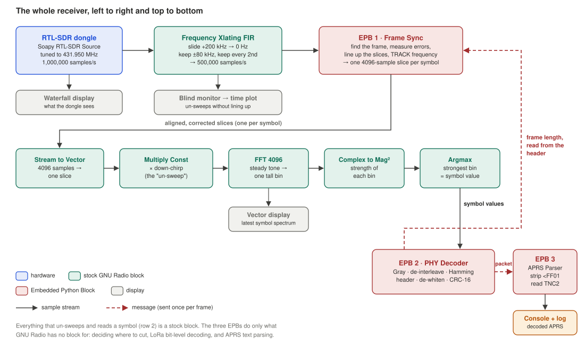

Green boxes are stock GNU Radio blocks, coral ones are my three Embedded Python Blocks, grey ones are displays. Solid arrows carry samples; dashed arrows carry messages, once per frame. Keep this picture in mind; the rest of the story walks through it from left to right and top to bottom.

---

## Part 1: what a LoRa APRS signal actually is

### LoRa, APRS, and LoRa APRS

**LoRa** is Semtech's long-range modulation, built into cheap modules like the SX1278 (433 MHz) and SX1262. It trades speed for range, so hard that it can be received below the noise.

**APRS** you probably know: `CALLSIGN>DEST,PATH:information`, normally as AX.25 packets at 1200 baud on VHF.

**LoRa APRS** is the same APRS text on LoRa instead of AX.25. Each packet is:

- three marker bytes, `<` `0xFF` `0x01`;
- then the APRS line as plain text (the "TNC2" format: `YB1SDL-9>APRS,WIDE2-2:!0620.56S/...`);
- and that's it. No AX.25, no extra checksum. The LoRa chip's CRC-16 is the only error check.

The settings my network uses:

| Setting | Value | What it means |
|---|---|---|
| Frequency | 432.150 MHz | Channel centre |
| Bandwidth (BW) | 125 kHz | Width of each chirp's sweep |
| Spreading factor (SF) | 12 | 4096 possible positions per chirp; the slowest, longest-range setting |
| Coding rate (CR) | 4/5 ("CR5") | 4 data bits get 1 check bit |
| Sync word | 0x12 | A network ID; LoRa APRS uses the SX127x "private network" value |
| Low data rate mode | On | Automatic at SF12/125 kHz. Hold that thought. |

### Chirps

Every LoRa **symbol** is a **chirp**: a tone sweeping steadily upward across the 125 kHz channel. At SF12 one chirp lasts 4096/125,000 s = **32.8 ms**. The data is *where in the sweep the chirp starts*:

- symbol 0 starts at the bottom edge;
- symbol 1000 starts 1000/4096 of the way up;
- when the sweep hits the top edge, it jumps back to the bottom and carries on (I call that jump "the fold").

The 4096 steps are called **chips**, and 125,000 of them go by every second. In complex baseband, one sample per chip, the plain up-chirp is

$$c[n] = e^{\,j2\pi\left(\frac{n^2}{2N} - \frac{n}{2}\right)}, \qquad N = 2^{SF} = 4096,$$

and symbol $s$ is the same chirp started $s$ chips further along its sweep.

### What a frame looks like

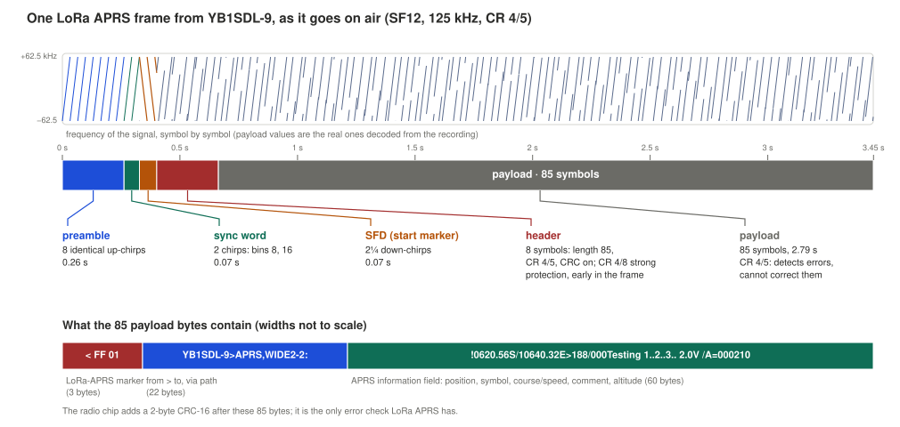

The top strip is the frequency of my tracker's signal, chirp by chirp. The payload chirps are the real values I decoded from my recording. Underneath is the frame on a time scale, and at the bottom, what the 85 payload bytes say.

| Part | Length | Duration | What it's for |
|---|---|---|---|
| **Preamble** | 8 identical up-chirps | 0.26 s | "Wake up, a frame is coming." My receiver finds frames by these. |
| **Sync word** | 2 chirps, values 8 and 16 | 0.07 s | Network ID 0x12. Other networks get ignored. |
| **SFD** | 2¼ *down*-chirps | 0.07 s | Marks where the data starts, and separates timing errors from tuning errors (Part 3) |
| **Header** | 8 symbols | 0.26 s | Length (85 bytes), coding rate, CRC on. Heavily protected. |
| **Payload** | 85 symbols | 2.79 s | My packet plus the CRC. Lightly protected. |

That's **3.45 s on air**, for 85 bytes. LoRa at SF12 is not in a hurry.

Notice the contrast between the header and the payload: the header is early and strongly protected; the payload is long, late and barely protected at all. Hold that thought too. It's exactly why my problem in Part 2 looked like "header fine, payload broken".

### The number to remember: 30.5 Hz

A chirp's position comes in 4096 steps across 125 kHz. Each step, which I'll call a **bin**, is

$$\frac{125\,000}{4096} = 30.5\ \text{Hz}.$$

On a 432 MHz carrier, that's 0.07 ppm. Thirty hertz. Remember it. Everything in Part 2 comes down to this one number.

---

## Part 2: un-sweeping, or how a chirp becomes a number

### Step 1: tuning in

Nothing exotic here, two blocks:

1. **The dongle sits at 431.950 MHz**, 200 kHz below the channel, at 1 MS/s. Every RTL-SDR has a spike of junk right at its tuned frequency (DC offset), so I tune off to one side and keep the spike out of the channel.
2. **One Frequency Xlating FIR Filter** does three jobs: slides 432.150 MHz down to 0 Hz, filters to ±80 kHz (LoRa needs ±62.5 kHz), and keeps every second sample. Out come 500,000 samples per second: **4 samples per chip**.

Why 4 per chip, when reading a chirp only needs 1? Timing. If I take my one-per-chip samples half a chip off, the chirp reads up to 4 dB weaker and the decision gets ambiguous. With 4 per chip I can pick the best of four sampling moments later.

A little bonus I got for free: the dongle's reference crystal runs at 28.8 MHz, and 15 × 28.8 = **432.000 MHz exactly**. That harmonic shows up on my waterfall as a steady vertical line, 150 kHz below my channel. With the dongle at 431.950 MHz, it lands outside the filter and does no harm. You can spot it in my screenshots.

### Step 2: mixing with an opposite sweep

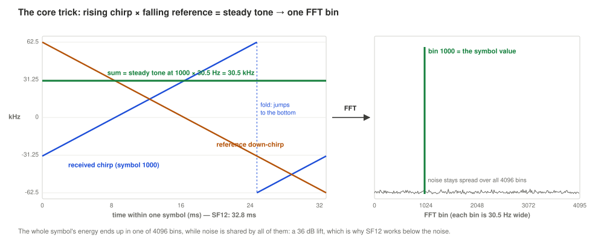

This is the heart of every LoRa receiver, and it's beautifully simple. Take the received chirp, sweeping **up**. Multiply it by a home-made chirp sweeping **down** at exactly the same rate (the conjugate, $c^*[n]$). Like any mixer, the output frequency is the sum of the two:

- the incoming frequency rises steadily,
- my reference falls steadily,
- **so the sum stays constant.** A plain, steady tone.

In maths, the quadratic parts cancel:

$$x_s[n]\,c^*[n] = (\text{constant})\cdot e^{\,j2\pi\frac{s}{N}n}$$

and what's left is a pure tone whose frequency is $s$ bins: **the symbol value**. The fold doesn't spoil it. After the fold the sum is exactly one channel-width away, and at one sample per chip that aliases right back onto the same tone. When I first saw that work, LoRa stopped looking like magic.

This step is called **de-chirping**, or un-sweeping.

### Step 3: the FFT gathers it up

An FFT is a frequency analyser. Feed it one chirp's worth of de-chirped samples (4096 of them) and it splits them into 4096 bins. The steady tone lands in **one bin**. The number of the strongest bin is the symbol.

And this is LoRa's below-the-noise trick. The chirp's energy, spread over the full 125 kHz, gets gathered into one bin, while the noise stays spread over all 4096. So the signal stands out by a factor of 4096, **36 dB**. That's how the iGates hear my tracker at −18 dB.

All of this is stock: **Stream to Vector** (4096) → **Multiply Const** (× down-chirp) → **FFT** (4096) → **Complex to Mag²** → **Argmax**. Five blocks, and out comes a number per chirp. The hard part is making sure each slice I feed them is *exactly* one chirp. That's Part 3.

---

## Part 3: finding a frame, the Frame Sync

### Two errors that look the same

Before it can read anything, my receiver has to work out two things nobody tells it:

| Unknown | Why it exists | How big for me |
|---|---|---|
| **Timing**: where each chirp starts | The tracker transmits whenever it likes | anything up to a whole chirp |
| **Tuning error** (CFO, carrier frequency offset) | Neither the tracker's crystal nor my dongle's is exact | I measured −333 to +334 Hz |

The annoying part: **both move the tone in the same way.** A slice that starts 10 chips late makes an up-chirp read 10 bins high. A tuning error of 10 bins (305 Hz) *also* makes it read 10 bins high. From up-chirps alone you can't tell which is which.

That's what the SFD's down-chirps are for. For a down-chirp, a timing error moves the tone the *opposite* way, while a tuning error moves it the *same* way. Measure both and the two errors separate. Neat. (My earlier write-up, `lora_rx_plain_english.md`, takes this apart in detail.)

There's a third, slower error too: **clock drift**. In the RTL-SDR, one crystal sets both the tuning and the sampling clock. In the tracker's LoRa chip, one crystal sets both the carrier and the chirp timing. So a tuning error always comes with a matching clock error. My receiver measures the tuning error, works out the clock error from it ($L_{eff} = L\,(1 - \text{CFO}/f_c)$), and stretches its slice timetable to match.

### The five stages

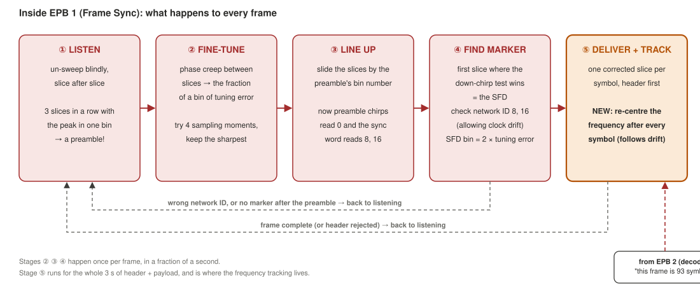

This is my first Python block, the **Frame Sync**. It works through five stages for every frame:

**① Listen.** It de-chirps the stream slice after slice on an arbitrary timetable. On noise, the strongest bin jumps around at random. During the preamble, all eight chirps are identical, so **every slice peaks in the same bin**, misaligned or not. My rule: *three slices in a row with their peak in the same bin (±1), each standing at least 11 dB above the average bin* = a frame has started. Noise alone does that roughly once in 10¹² slices.

**② Fine-tune.** The preamble repeats exactly, so each slice's peak is identical, except that a tuning error makes its *phase* creep by the same amount every slice. A whole-bin error makes a full turn and hides, but the fraction of a bin shows up, and I correct it. Then I try all four sampling moments and keep the sharpest.

**③ Line up.** Slide the slice timetable by the preamble's bin number. Now the preamble reads 0 and the sync word reads 8 and 16. The slide has swallowed timing *plus* tuning error together, which the next stage untangles.

**④ Find the marker.** Step forward one chirp at a time, de-chirping each slice both ways (as an up-chirp and as a down-chirp). The first slice where the down-chirp reading wins is the SFD. Then:

- **check the network ID**: the two readings before the SFD must be 8 and 16 (allowing for clock drift; see war story 2);
- **separate the errors**: the SFD reading is twice the whole-bin tuning error. Add the fraction from ②, and I have the full CFO, printed in Hz;
- **fix the timing**: the header starts exactly 2¼ chirps after the start of the SFD.

The SFD trick only works if the tuning error is under a quarter of the channel, **±31.25 kHz**. At 432 MHz that's ±72 ppm of combined crystal error. Plenty.

**⑤ Deliver, and track.** From the header on, the Frame Sync hands out **one clean slice per chirp**: on time, at the best sampling moment, re-tuned and drift-corrected. The first one carries a "frame start" tag.

But how long is the frame? It doesn't know: the length is *inside* the header. So it delivers the 8 header chirps and waits. My decoder reads the header and sends a message back, "this frame is 93 symbols", and the Frame Sync delivers the rest. A bad header means "abort", and back to listening. In GRC that's just a dashed message connection going backwards. (Message loops are allowed; stream loops aren't.)

The "and track" in stage ⑤ is new. It's the fix from Part 6, and it's the reason this receiver now works on my tracker at all.

---

## Part 4: from numbers to bytes

My second Python block, the **PHY Decoder**, runs the transmitter's recipe backwards.

### One number → bits

| Step | What happens | Why |
|---|---|---|
| Subtract 1 | Undo a +1 offset the transmitter adds | A LoRa quirk |
| Gray code | Re-order the value so neighbours differ by one bit | A near-miss then costs one bit, not several |
| **Drop the lowest 2 bits** | Keep 10 bits instead of 12 | Low data rate mode (below) |

Remember "hold that thought" about **low data rate mode**? At SF12/125 kHz a chirp lasts 32.8 ms, long enough for small frequency and timing slips to matter. Semtech's answer: use only 10 of the 12 bits. In effect, the 4096 positions are used in **groups of four**, and only the group counts. The header always works this way, even at lower SFs.

How exactly the chip places a symbol *inside* its group of four turned out to be the key to everything in Part 6.

### Bits → bytes

LoRa interleaves the bits diagonally across chirps, so one bad chirp damages one bit in many code words instead of many bits in one. After un-shuffling, the error code:

| Part | Coding rate | What it can do |
|---|---|---|
| Header | **4/8** | **Corrects** one wrong bit per code word |
| Payload | **4/5** | Only **detects** an error. Can't fix it. |

Then de-whiten (LoRa scrambles the bytes with a fixed pseudo-random sequence) and check the CRC-16. **With CR 4/5, one wrong chirp anywhere in my 85 payload chirps means a failed CRC.** The header, by contrast, shrugs off a bad bit or two. You can probably see where this is going.

---

## Part 5: from bytes to a dot on the map

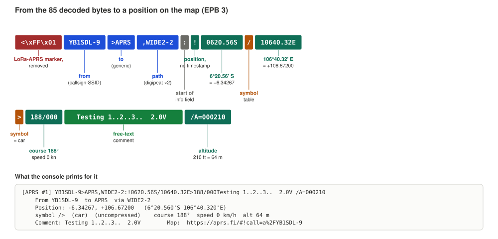

My third Python block, the **APRS Parser**, gets each decoded packet as a message and:

1. drops frames that failed the LoRa CRC (set `show_bad_crc=True` if you want to see them anyway);
2. strips the `<` `0xFF` `0x01` marker;
3. splits `SOURCE>DEST,PATH:info`;
4. decodes the info field by its first character:

| First character | Type | Decoded into |
|---|---|---|
| `!` `=` | Position | Lat/lon, symbol, course/speed, `/A=` altitude, comment |
| `/` `@` | Position with timestamp | Same, plus the time |
| (compressed form) | Base-91 position, as many LoRa trackers send | Same, from the compressed bytes |
| `` ` `` `'` | Mic-E | Position hidden in the destination field, speed, course, status, altitude |
| `:` | Message | Addressee, text, message number, ack/rej |
| `>` | Status | Text |
| `;` `)` | Object / item | Name, position |
| `T#` | Telemetry | Printed as is |
| `}` | Third-party | The inner packet, decoded again |

5. prints it all with an aprs.fi link, optionally appends to a log file (`log_path`), and puts the bare TNC2 line on its `aprs` message output, so a stock Socket PDU could pass it on to another program.

I checked every field against the `aprslib` Python library on compressed, uncompressed, Mic-E, message and status packets. They all agreed.

---

## Part 6: the night it decoded one frame in ten

### The symptom

Just after midnight on my first night on air, my receiver heard YB1SDL-9 ten times and decoded it **once**:

| Frame | Tuning error | Sync word | Header | Payload CRC | SNR |
|---|---|---|---|---|---|
| 1 | −47 Hz | 8, 16 ✓ | length 85 ✓ | **OK** | 17 dB |
| 2–10 | +206 … +334 Hz | 8, 16 ✓ | length 85 ✓ | **FAIL** | 14–25 dB |

Everything up to and including the header was perfect, every single time. The SNR was excellent, 35–45 dB above where SF12 starts to struggle. And the iGates around me decoded every one of those frames, some of them at −18 dB.

So my tracker was fine, the signal was strong, and something in my receiver broke **only in the payload**: the long, lightly protected part.

### Three suspects

| Suspect | Why it fitted | Why it might not |
|---|---|---|
| **My tracker drifts *during* each transmission** | My Frame Sync measured the frequency once, on the preamble, then froze it for 3 s. At 30.5 Hz per bin, a few tens of Hz of drift pushes late chirps toward the next bin. The header (early, protected) survives; the payload (late, unprotected) doesn't. And the tuning error had jumped ~280 Hz between frames 1 and 2: an oscillator on the move. | My simulations said the receiver tolerated ~120 Hz of steady drift, which sounded like plenty |
| **Lost samples on my laptop** | A gap of a few samples in a 3.5 s frame shifts every chirp after it: header fine, payload garbage | No overflow warnings |
| **My dongle's oscillator drifting** | Same symptom | Dongles warm up over minutes, not seconds |

I couldn't settle it by staring at the console. I needed a recording.

### What the recording showed me

I recorded one frame in Gqrx: 300 kS/s, centred on 432.150 MHz, 32 MB for a single transmission (one the iGates had decoded). I resampled it to my receiver's rate and played it through the flowgraph.

**It decoded.** CRC OK, YB1SDL-9, same 85 bytes. So the signal was fine, and whatever went wrong live was something that changes from frame to frame.

Then I did what I should probably have done first: I measured the recording **symbol by symbol**. For each of the 93 header and payload chirps, how far does its peak sit from the centre of its bin?

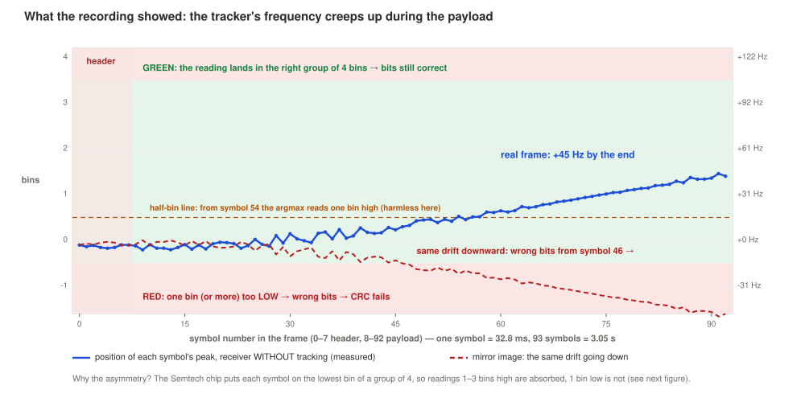

The blue line is what a receiver without tracking sees in my real frame. (Ignore the dashed red line and the coloured bands for a minute; they come later.)

- **Header and the first ~25 payload chirps:** flat, about −0.13 bin. Steady.
- **From about 0.8 s into the payload:** a steady climb.
- **By the end:** +1.4 bins. About **+45 Hz** above where it started.

A flat start, then a ramp once the transmitter has been on for a while. That's the classic signature of a **transmitter warming up while it transmits**: the PA draws current, the module heats, the crystal moves. My dongle in Gqrx had been running for minutes and wouldn't start ramping exactly when my tracker keyed up. I'd put about 80 % on the drift being in the tracker. Most LoRa APRS trackers use modules with a plain crystal, not a TCXO, and tens of hertz in a few seconds at 432 MHz is entirely plausible for those.

But there was a puzzle. From symbol 54 on, the peak sat past the half-bin line, so the receiver read those chirps **one bin too high**: 38 chirps in all. And the frame *still* passed its CRC. With CR 4/5, a single wrong chirp should kill it. So why were 38 harmless?

### Groups of four

I printed the exact symbol values from the recording, and there it was: **every one of the 93 chirps sat on the lowest bin of its group of four.**

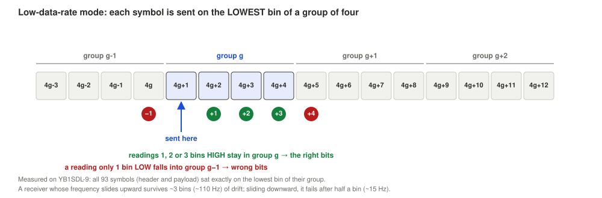

Remember the low data rate mode from Part 4: only the *group* of four matters. Group $g$ covers bins $4g+1$ to $4g+4$, and my tracker always transmits on the first of them, $4g+1$. Never on the other three.

So:

- read a chirp **1, 2 or 3 bins too high**, and you're still in group $g$. **The bits are fine.**
- read it **just 1 bin too low**, and you've fallen into group $g-1$. **Wrong bits, CRC fails.**

The safety margin is **lopsided**:

| Drift direction | Margin before the bits go wrong | In Hz at SF12 |
|---|---|---|
| Upward | about 3½ bins | about **+110 Hz** |
| Downward | about ½ bin | about **−11 to −15 Hz** |

Suddenly everything fitted:

- **My recorded frame drifted up** (+45 Hz). Its 38 misread chirps were all one bin *high*, inside the margin. Harmless. It decoded.
- **The same drift going down** (the dashed red line in the chart above) pushes chirps one bin *low* from about symbol 46. One of those is enough.
- **The iGates** don't care, because a real LoRa receiver follows the frequency through the payload. Mine didn't.

### Testing the prediction

A theory is only worth something if it predicts. So I took the real recording and added an extra *downward* ramp over the payload, on top of the natural +45 Hz:

| Total drift during the payload | My receiver without tracking |
|---|---|
| +45 Hz (as recorded) | decodes |
| **−15 Hz** | **fails** |
| −30, −45, −60, −100, −300 Hz | fails |

**Fifteen hertz downward, half a bin, breaks every frame.** At 432 MHz that's 0.035 ppm in three seconds. A plain crystal does that without even trying.

Back to my live session: from frame 4 on, the tuning error fell steadily from frame to frame: +334, +298, +293, +276, +254, +231, +206 Hz. A tracker whose frequency falls between frames is very likely falling *within* frames too. I didn't record those frames, so I can't prove it, but it's the only explanation that fits everything I saw (I'd say about 80 %). And the fix below handles it either way.

Why didn't my simulations catch it? I'd tested with the EPFL gr-lora_sdr transmitter as a signal generator, and I checked afterwards: it places symbols on the lowest bin of each group too, exactly like my tracker. So the lopsided margin was there in simulation all along. The problem was me: **every drift I simulated went upward**, the one direction my receiver tolerated. A simulation only tests what you think of putting into it.

### The fix: follow the frequency through the payload

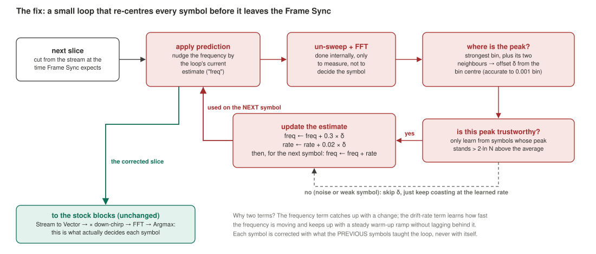

My old Frame Sync measured the frequency once, on the preamble, and held it for 3 s. It was like a navigator who takes one fix at the start of a voyage and never looks at the coast again. The new one takes a fix **on every chirp** and corrects its course a little each time.

Here's what happens for every chirp, inside stage ⑤:

1. **Apply the prediction.** Nudge the slice's frequency by the loop's current estimate, $\hat f$ (in bins).
2. **De-chirp and FFT, internally.** Only to *measure*. The stock blocks downstream still make the actual decision.
3. **Find the peak, to a fraction of a bin.** The strongest bin and its two neighbours give the offset from the bin centre:
   $$\delta = \text{Re}\left\{\frac{Y[m-1]-Y[m+1]}{2Y[m]-Y[m-1]-Y[m+1]}\right\}$$
   On clean test tones that's accurate to 0.001 bin, about 0.03 Hz. Not bad for three numbers.
4. **Is the peak trustworthy?** Only learn from peaks standing at least 12 dB above the average bin. A noise spike or a faded chirp doesn't get a vote.
5. **Update:**
   $$\text{rate} \leftarrow \text{rate} + 0.02\,\delta, \qquad \hat f \leftarrow \hat f + 0.3\,\delta + \text{rate}$$
6. **Send the corrected slice** on to the stock blocks.

Why two terms? With only the first, the loop would always trail behind a steady ramp: by the time it catches up with one chirp's drift, the frequency has moved on. The rate term is dead reckoning. Having seen the frequency climb about two-thirds of a hertz per chirp, it *expects* the next one to be that much higher and corrects in advance. With both, it follows a warm-up ramp with almost no lag. (For the curious: it's a type-2 loop with poles at 0.92 and 0.77, a time constant of about 12 symbols, and zero steady-state error to a ramp. The technical write-up has the details.)

One more subtle point I like: each chirp is corrected using what the **previous** chirps taught the loop, never its own measurement. If a chirp sat exactly on a half-bin boundary, correcting it with its own reading would be a coin toss. Predicting from the chirps before it puts it near the bin centre *before* anyone decides anything.

And why 0.3 and 0.02? I also tried gentler gains (0.15 and 0.006). No improvement at −20 dB, and they lost my heaviest drift test (+345 Hz). So 0.3 / 0.02 stayed.

The cost is one extra 4096-point FFT per 32.8 ms chirp. Pocket change. It still fits my rule, too: no stock block can feed a measurement back into the next slice, so this belongs inside the Frame Sync. The decisions are still made by the stock FFT and Argmax. There's a `track` parameter to switch it off if you want to see the old behaviour.

### Did it work?

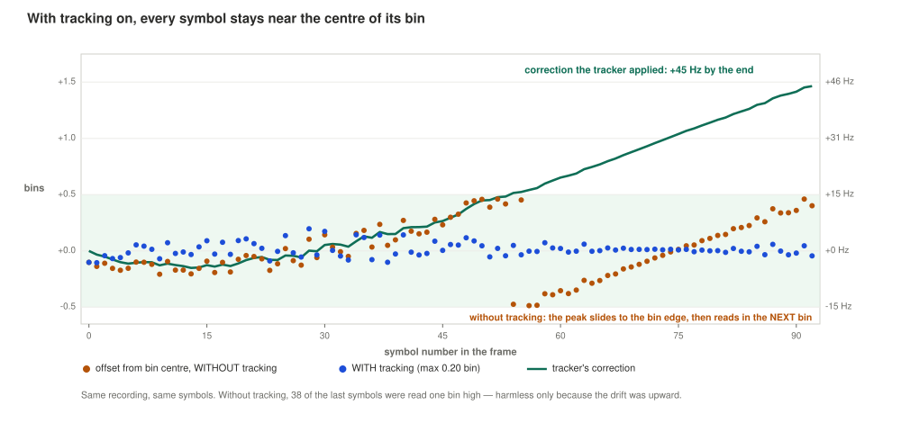

Orange is without tracking: the peaks slide to the bin edge and wrap into the next bin. Blue is with tracking: every chirp stays within **±0.2 bin** of its centre. Teal is what the tracker applied: **+45 Hz** by the end, the same drift I'd measured by hand. That was a good moment.

Then I threw extra drift at my real frame, both ways:

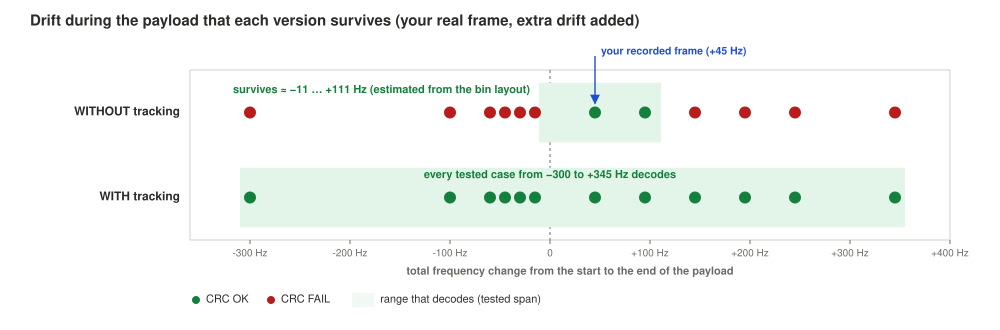

| Total drift during the payload | Without tracking | With tracking (what it reported) |
|---|---|---|
| −300 Hz | FAIL | OK (−299 Hz) |
| −100 Hz | FAIL | OK (−98 Hz) |
| −60, −45, −30 Hz | FAIL | OK |
| **−15 Hz** | **FAIL** | OK (−16 Hz) |
| +45 Hz (as recorded) | OK | OK (+44 Hz) |
| +95 Hz | OK | OK (+97 Hz) |
| +145, +195, +245 Hz | FAIL | OK |
| +345 Hz | FAIL | OK (+342 Hz) |

Every number it reported matches the drift I added, to within a few hertz. So "frequency tracked" on the console isn't just a debug line: it's a free measurement of my tracker's oscillator, every frame.

And then the real test: back on air, with the updated flowgraph. **YB1SDL-9 decodes live.** I may have cheered a little.

Here's the whole hunt on one page, dead end included:

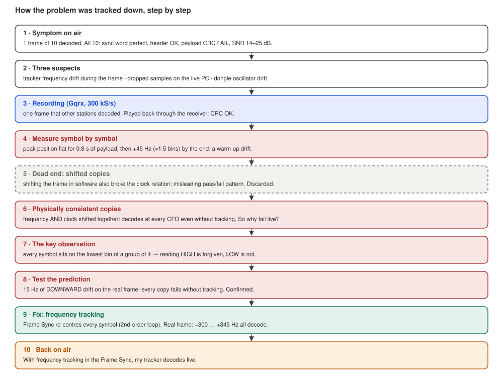

---

## Part 7: war stories (the smaller bugs that taught me something)

The drift was the big one, but not the only one. Here are the others worth telling, because each one is a lesson beyond LoRa.

### 1. The shifted copies that lied

Before I found the groups-of-four story, I fooled myself. I wanted to know if the tuning error itself mattered, so I shifted my recorded frame in software to each of the live tuning errors (−47, +232, +312 Hz...) and replayed them. Some failed! It looked like I'd reproduced the problem.

I hadn't. In real hardware, a tuning error never comes alone: the crystal that sets the frequency also sets the clock. By shifting only the frequency, I left the clock untouched. My receiver, which works out the clock correction from the tuning error, then "corrected" a clock drift that didn't exist, and pushed late chirps one bin low. The failures came from my test, not my receiver. (Funnily enough, through the very same one-sided margin.)

Remade properly, with frequency *and* clock shifted together, all twelve copies from −600 to +400 Hz decoded, even without tracking. Lesson: **a test signal must be physically consistent with the thing it imitates.** Move one thing that's tied to another, and you get very convincing nonsense.

### 2. The sync word that drifted away

In early testing my receiver rejected **every** frame at ±60–70 ppm of combined crystal error. The sync word should read 8 and 16, and it read 6 and 14. Wrong network? No: clock drift. Between lining up on the preamble and reaching the sync word, the timetable had slipped about 2 chips at SF12, and both readings moved together.

The fix: accept the sync word if both readings are shifted by the *same* amount (up to 3.5 chips), and use that shift as a free drift measurement when separating the tuning error. A 0x34 LoRaWAN network (24, 32) is still rejected. ±60–70 ppm now decodes. Lesson: when two readings are off by the same amount, that's information, not an error.

### 3. A detector too strict for SF12

My original "found a preamble" rule wanted four slices in a row at about 12 dB above the average bin. At −20 dB, right where SF12 lives, it found 1 frame in 5. Three slices at 11 dB found 4 to 5 in 5, and the false-alarm rate is still about one in 10¹² slices. Lesson: tune the detector for the SF you actually run, not the one you tested first.

### 4. GRC sizes Python ports with the default arguments

This one's from building the original receiver, and it still bites. GRC works out an Embedded Python Block's port sizes by building it once with the **default values in the code**, not the values you type in the block's properties. So a vector port of length $N$ stayed at the default SF's length, and every other SF gave red connections. The Frame Sync now outputs a plain stream in 4096-sample chunks, and a stock **Stream to Vector** makes the vectors. Lesson: never make an EPB port's size depend on a parameter.

### 5. The smaller ones

- **The SNR readout saturates.** My recording has about 39 dB in-band SNR; the receiver reports 21.7 dB. Filter edges and tiny misalignments leak a little energy out of the peak bin, and that counts as "noise". At low SNR it's accurate (−16.0 dB for a −15 dB channel). Read high numbers as "strong", not exact.
- **Gqrx records at its own rate.** 300 kS/s centred on the channel, versus my receiver's 1 MS/s at +200 kHz. A polyphase resampler (×10/3) plus a 200 kHz shift fixed that, but a recording has to be at an integer multiple of 125 kHz before the Frame Sync will touch it.
- **Waterfalls undersell LoRa.** An SF12 frame only shows on the waterfall above roughly −5 dB SNR. The decoder works down to −20 dB. A blank waterfall doesn't mean nothing's there.

---

## Results

On my real tracker, YB1SDL-9:

- **Live:** decodes on air with the current flowgraph (1 frame in 10 before the tracking fix).
- **The recorded frame:** decodes byte-exact, with the tracker measuring +45 Hz of drift over the payload.
- **Drift tolerance on that frame:** every tested case from −300 to +345 Hz with tracking; only about −11 … +111 Hz without.
- **Noise added to that frame,** down to −20 dB in-band SNR: 6 of 6 decoded.

On simulated frames (EPFL gr-lora_sdr transmitter as the signal source, with noise, crystal error and the matching clock drift):

- Reliable down to **−20 dB** in-band SNR, about Semtech's own SF12 limit. Below that, frames still sync but CR 4/5 can't save the payload.
- Crystal error up to **±70 ppm** (±30 kHz at 432 MHz); +76 ppm fails, as the ±31.25 kHz limit predicts.
- Linear drift of 80 Hz/s (~260 Hz per frame): 0/5 without tracking, 5/5 with it.
- 30 frames at −20 dB: 27/30 without tracking, 26/30 with. One frame, within the noise of the test.
- Every APRS field matches `aprslib`.
- About **15× faster than real time** on two cores, GUI included.

---

## How to run it

1. Open **lora_aprs_rx.grc** in GRC (GNU Radio 3.10).
2. Check the variables at the top:
   - `center_freq` = 432.150e6. This also drives the clock-drift correction, so get it right.
   - `sf` = 12, `bw` = 125e3, `sync_word` = 0x12. `ldro` sets itself.
   - `rtl_ppm`: 0 for a TCXO dongle; your measured error otherwise.
3. Run, and set the gain slider to around 30 dB.
4. Wait for a beacon and watch the console.

You'll see three lines per frame, then the APRS block:

```
[LoRa sync] frame 1: SNR 17.2 dB, CFO -47 Hz (-2 + 0.47 bins), sync word bins [8, 16] (drift +0.0 chips), sampling phase 0/4
[LoRa sync] frame 1: frequency tracked +44 Hz over the payload
[LoRa RX] frame 1  len 85  CR 4/5  CRC OK  CFO -47 Hz  SNR 17.2 dB
```

"Frequency tracked" is how far your tracker's oscillator moved during that transmission. It's become my favourite number on the screen.

On the GUI:

- **Waterfall**: the whole 1 MHz. A frame is a 125 kHz stripe at 432.150 MHz for 2–4 s, next to the 432.000 MHz spur line.
- **Blind de-chirp plot**: one dot per 32.8 ms slice. A preamble is a flat run of dots; the sync word is two steps.
- **Synchronised spectrum**: one sharp spike per symbol, once the Frame Sync has done its job.

A few notes:

- **To play a recording:** disable the RTL-SDR source, enable the File Source and Throttle, and point `rec_file` at a complex64 file at 1 MS/s tuned to 431.950 MHz. Anything else needs resampling first (war story 5).
- **`sync word bins ... != (8, 16)`** with steady numbers: another network on the channel. Not a bug.
- **`header checksum failed`** at good SNR: wrong `sf`/`ldro`, or the dongle's overloaded. Lower the gain first.
- **`CRC FAIL` with a good header:** look at "frequency tracked". A big number means your tracker drifted more than the loop could follow; record that frame. A small number points at lost samples on the PC.

---

## TODO

There's a lot of room for improvement!

- **A symmetric group decision.** LoRa always transmits on the *lowest* bin of each group, so the decoder could round to the nearest group start instead of rounding down. That would give about ±1.5 bins of margin both ways, even without tracking. It needs testing against more trackers than mine first.
- **Record a frame that fails live**, to confirm the downward-drift story directly instead of at 80 %.
- Test drift beyond ±300 Hz per frame.
- Handle **overlapping frames** (two trackers at once).
- A proper **iGate output**: forward the TNC2 lines to APRS-IS through a stock Socket PDU.
- A long unattended run, to see how many frames it catches against the iGates around me.

---

## Acknowledgements

- The **GNU Radio** project, and **radioconda** for making it painless on Windows.
- **osmocom / rtl-sdr** and the **SoapySDR** developers.
- **Semtech**, for LoRa and the SX127x/SX126x documentation.
- **J. Tapparel et al., EPFL**, for **gr-lora_sdr**: its reverse-engineered LoRa PHY was my reference for the bit-level chain, and its transmitter was my test-signal generator.
- The **LoRa APRS** firmware community, for settling on the `<\xFF\x01` + TNC2 format that makes all of this so simple.
- **aprslib**, for checking my APRS parsing against.
- The **iGates around me** that kept decoding YB1SDL-9 while my receiver couldn't. Proof that the problem was mine.
