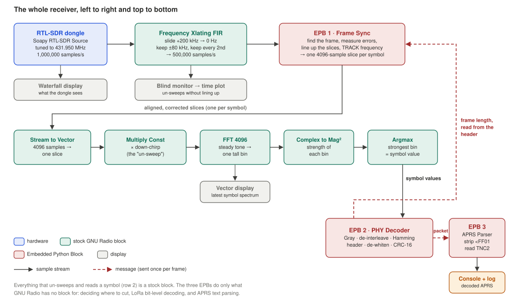
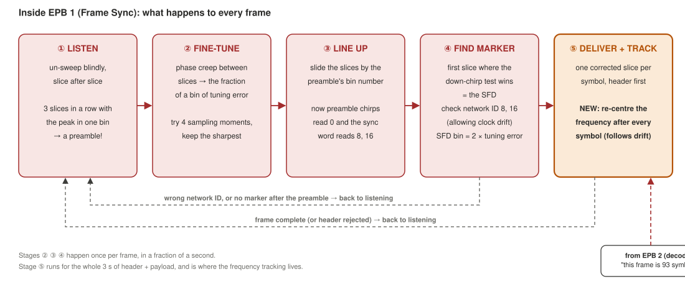
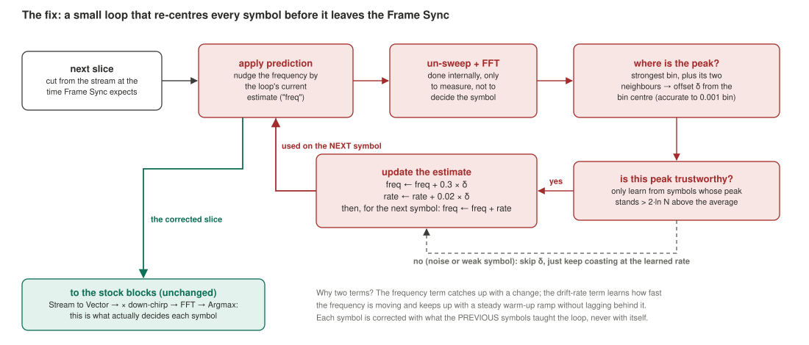
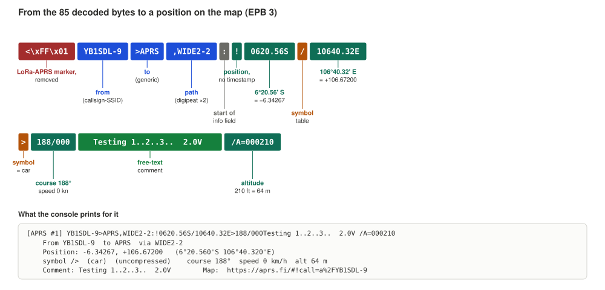
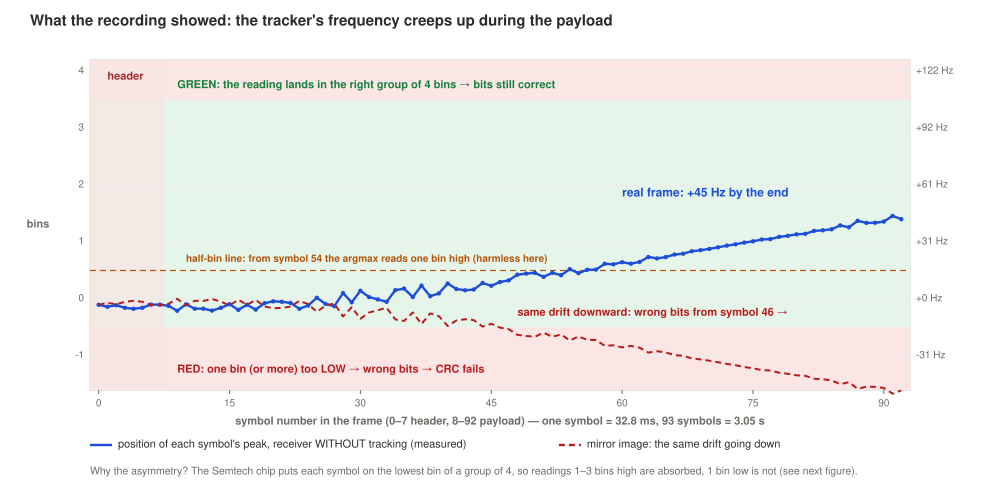
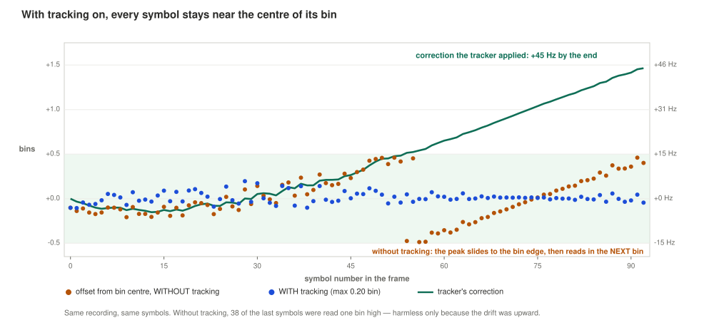
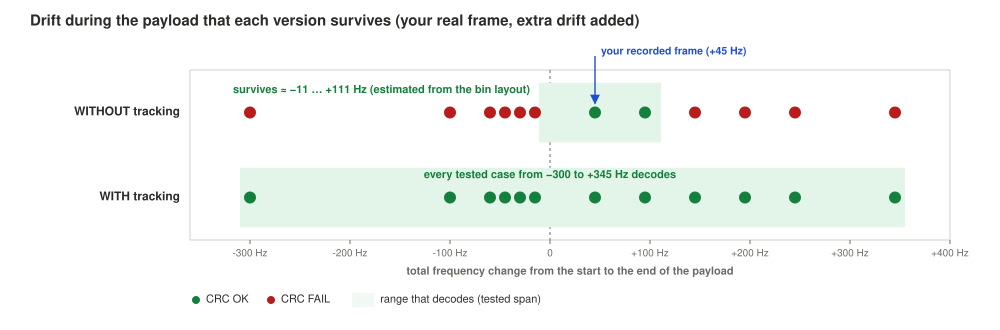

# LoRa APRS Receiver: Technical Description

**432.150 MHz · SF12 · 125 kHz · CR 4/5 · RTL-SDR · GNU Radio 3.10, stock blocks plus three Embedded Python Blocks**

**Flowgraph:** `lora_aprs_rx.grc`. I compiled it with `grcc` 3.10.9 and run it on GNU Radio 3.10.10 (radioconda, Windows). No LoRa out-of-tree modules are used.

**Companion documents:**

- `README.md`: the same receiver and the drift investigation, written as a narrative without maths.
- `lora_rx_explained.md`: the technical description of my original LoRa receiver (`lora_trx_sim.grc`), from which this one is derived. It derives the de-chirp and synchronisation steps in more detail than I repeat here.

**Figures:** I reuse the `lora_aprs_pe_*.svg` diagrams from the plain-English document; they need to sit in the same folder. The data plots are computed from a Gqrx recording of my tracker, YB1SDL-9.

---

## Contents

1. [Scope and summary](#1-scope-and-summary)
2. [Air-interface parameters](#2-air-interface-parameters)
3. [Signal chain](#3-signal-chain)
4. [Front end](#4-front-end)
5. [Demodulation principle](#5-demodulation-principle)
6. [Frame synchronisation (EPB 1)](#6-frame-synchronisation-epb-1)
7. [Payload frequency tracking (EPB 1)](#7-payload-frequency-tracking-epb-1)
8. [PHY decoding and the low-data-rate symbol mapping (EPB 2)](#8-phy-decoding-and-the-low-data-rate-symbol-mapping-epb-2)
9. [APRS layer (EPB 3)](#9-aprs-layer-epb-3)
10. [Root-cause analysis of the first on-air test](#10-root-cause-analysis-of-the-first-on-air-test)
11. [Verification](#11-verification)
12. [Operation](#12-operation)
13. [Limitations and possible improvements](#13-limitations-and-possible-improvements)

---

## 1. Scope and summary

This document describes the receiver as it stands after the first on-air tests: the signal chain, the synchroniser, the payload frequency-tracking loop I added after those tests, the PHY and APRS decoding, and the measurements behind each design decision.

Summary of the main results:

| Item | Result |
|---|---|
| Real tracker (YB1SDL-9), recorded frame | Decodes byte-exact |
| Real tracker, live | Decodes after the tracking fix; 1 of 10 frames before it |
| Root cause of the live failures | Transmitter frequency drift within the frame, combined with a one-sided symbol-decision margin in low-data-rate mode (§10). About 80 % confidence; the failing frames were not recorded. |
| Drift tolerance on the real frame | ≈ −11 … +111 Hz without tracking; every tested case from −300 to +345 Hz with tracking |
| Sensitivity (simulated, reference transmitter) | Reliable to −20 dB in-band SNR; Semtech's quoted SF12 limit is about −20 dB |
| CFO range | ±BW/4 = ±31.25 kHz, i.e. ±72 ppm combined at 432 MHz |
| CPU | ≈15× faster than real time on two cores with all GUI sinks |

---

## 2. Air-interface parameters

| Parameter | Value | Derived quantity |
|---|---|---|
| Carrier | 432.150 MHz | 1 ppm = 432 Hz |
| Bandwidth BW | 125 kHz | chip rate 125 kchip/s |
| Spreading factor SF | 12 | N = 2¹² = 4096 chips per symbol; T_sym = N/BW = 32.768 ms |
| FFT bin width | BW/N | **30.52 Hz** (0.0706 ppm at 432.15 MHz) |
| Coding rate | 4/5 (payload) | header always 4/8 |
| Low data rate optimisation (LDRO) | on | mandatory when T_sym > 16 ms; 10 bits per payload symbol |
| Sync word | 0x12 | on-air bins (8, 16) |
| Preamble | 8 up-chirps | +2 sync +2.25 SFD = 12.25 symbols before the header |
| Explicit header | yes | 8 symbols, SF−2 bits, CR 4/8 |
| Payload CRC | on | CRC-16 (CCITT 0x1021) |

For my 85-byte packet, the number of header-plus-payload symbols is

$$n_{sym} = 8 + \left\lceil \frac{8\cdot 85 - 4\cdot 12 + 28 + 16}{4\,(12-2)} \right\rceil (4+1) = 8 + 17\cdot 5 = 93,$$

so the frame lasts (12.25 + 93) × 32.768 ms = **3.449 s**, of which the 85 payload symbols take 2.785 s. The net bit rate is 10 × 4/5 / 32.768 ms ≈ 244 bit/s.

---

## 3. Signal chain



| Function | Block | Implementation |
|---|---|---|
| Tuning and sampling | Soapy RTL-SDR Source (in-tree gr-soapy), 1 MS/s at 431.950 MHz | stock |
| Channel select, frequency shift, decimation | Frequency Xlating FIR Filter | stock |
| Free-running monitor | Keep 1 in N, Vector Source (down-chirp), Multiply, Stream to Vector, FFT, Complex to Mag, Argmax, Time Sink | stock |
| Preamble detection, CFO/STO estimation, SFD search, sync-word check, SRO compensation, **payload frequency tracking**, symbol windowing | **EPB 1: Frame Sync** | Python |
| De-chirp, FFT, symbol decision | Stream to Vector, Multiply Const, FFT, Complex to Mag², Argmax | stock |
| Gray mapping, de-interleaving, Hamming, header, de-whitening, CRC | **EPB 2: PHY Decoder** | Python |
| `<\xFF\x01` removal, TNC2 split, APRS format decoding | **EPB 3: APRS Parser** | Python |
| Displays | Waterfall, Time Sink, Vector Sink, QT GUI Range (gain) | stock |

My design rule is that every operation uses a stock block where one exists, and an EPB only where GNU Radio has no native equivalent:

- **EPB 1** is needed because no stock block can choose its own window boundaries from what it has just measured, or feed a measurement forward into the processing of the next window.
- **EPB 2** and **EPB 3** are needed because GNU Radio has no LoRa coding blocks and no APRS parser.

The de-chirp and the symbol decision are done by stock blocks.

Two message connections close the chain:

- **`frame_info`** (EPB 2 → EPB 1): `{'n_sym': n}` after the header is decoded, or `{'abort': True}` on a header checksum failure. EPB 1 cannot know the frame length in advance.
- **`payload`** (EPB 2 → EPB 3): one PDU per frame, with the metadata (CRC verdict, CFO, SNR) in the PDU's metadata dictionary.

---

## 4. Front end

| Stage | Setting | Reason |
|---|---|---|
| RTL-SDR centre | `center_freq − if_offset` = 431.950 MHz | keeps the dongle's DC spike and IQ-imbalance image away from the channel |
| Sample rate | `samp_rate` = 8 × BW = 1 MS/s | integer multiple of BW, as EPB 1 requires |
| Xlating FIR, centre | +200 kHz (`if_offset`) | channel to 0 Hz |
| Xlating FIR, taps | `firdes.low_pass(1, 1e6, 80e3, 20e3)` | passes ±62.5 kHz, stop band from 90 kHz |
| Decimation | 2 | 500 kS/s = **4 samples per chip** into EPB 1 |

**Why 4 samples per chip.** The de-chirp needs only one sample per chip. The extra resolution lets EPB 1 choose the sampling phase to within 1/8 chip. A half-chip sampling error costs up to about 4 dB of peak height and splits the peak between two bins.

**Reference spur.** The dongle's 28.8 MHz reference has its 15th harmonic at exactly 432.000 MHz. That is 150 kHz below the channel, i.e. +50 kHz relative to the dongle's centre frequency. After the −200 kHz shift it lands at −150 kHz, outside the ±90 kHz filter. I see it as a steady vertical line on the waterfall.

---

## 5. Demodulation principle

At one sample per chip, the base up-chirp is

$$c[n] = e^{\,j2\pi\left(\frac{n^2}{2N} - \frac{n}{2}\right)}, \qquad n = 0,\dots,N-1,$$

and symbol $s$ is the cyclic shift $x_s[n] = c[n+s]$. Multiplying by the conjugate base chirp cancels the quadratic phase:

$$x_s[n]\,c^*[n] = e^{\,j\phi_s}\,e^{\,j2\pi\frac{s}{N}n},$$

which is a pure tone that lands in bin $s$ of an N-point FFT. The FFT collects the symbol energy into one bin while noise stays spread over all N bins, so the processing gain is $10\log_{10}N$ = 36.1 dB at SF12. Window alignment is critical: a misaligned window contains two partial symbols and produces two weaker peaks.

With a timing offset of τ chips and a carrier offset of f bins, the peak of an **up-chirp** moves to bin $s + \tau + f$, and the peak of a **down-chirp** (de-chirped with $c[n]$) moves to bin $f - \tau$. Up-chirps alone cannot separate τ from f; the SFD down-chirps can. The derivation is in `lora_rx_explained.md` §4.

---

## 6. Frame synchronisation (EPB 1)



Notation: $L = N\cdot os$ input samples per nominal symbol ($os$ = 4); "window" = N samples taken every $os$-th input sample from a start index.

### 6.1 DETECT

Windows are taken on a free-running grid with step L, de-chirped with $c^*[n]$ and transformed. A window is a candidate if its peak-to-mean power ratio exceeds a threshold:

$$\frac{P[k^\*]}{\overline{P}} > \eta_{det}, \qquad \eta_{det} = 1.5\ln N = 12.5\ (11.0\ \text{dB}).$$

A preamble is declared after **3 consecutive candidate windows** whose peak bins differ by at most ±1.

| | First version | Current |
|---|---|---|
| Consecutive windows | 4 | 3 |
| Threshold | 2 ln N (12.2 dB) | 1.5 ln N (11.0 dB) |
| Frames detected at −20 dB in-band SNR (5 sent) | 1 | 4–5 |

**False-alarm estimate.** For noise, the bin powers are approximately exponential, so the per-window probability of exceeding the threshold is about $N e^{-\eta_{det}} = N^{-0.5}$ ≈ 1.6 % at SF12. Three such windows in a row with peaks within ±1 bin of each other give roughly $(0.016)^3 (3/N)^2 \approx 10^{-12}$ per window. A false alarm that does occur is rejected at the sync-word check.

### 6.2 ALIGN

1. **Fractional CFO.** Because the preamble is periodic in L, consecutive windows differ only by the carrier rotation over one symbol:
   $$f_{frac} = \frac{1}{2\pi}\arg\sum_i Y_{i+1}[k^\*]\,Y_i^*[k^\*] \ \in(-\tfrac12,\tfrac12]\ \text{bins}.$$
   From here on, every window is multiplied by $e^{-j2\pi f_{frac}\,m/L}$, where $m$ is the absolute input-sample index.
2. **Sampling phase.** For each of the $os$ = 4 phases, I sum the de-chirped power spectra of the last two preamble windows and keep the phase with the highest peak.
3. **Integer shift.** I move the grid back by the peak bin $k^\*$ (in chips). The preamble then de-chirps to bin 0. The shift contains $\tau + f_{int}$, so the grid is now offset by $-f_{int}$ chips, which the next stage resolves.

The SNR printed per frame is computed here: peak-bin power against mean noise-bin power, converted to in-band SNR. It is accurate at low SNR. Above roughly +15 to +20 dB it saturates, because filter edges and residual misalignment leak energy out of the peak bin. My recording has about 39 dB in-band SNR, but the receiver reports 21.7 dB for it.

### 6.3 SFD search and sync-word check (drift-aware)

Stepping by L, each window is de-chirped both with $c^*$ (up-chirp test) and with $c$ (down-chirp test). The first window where the down-chirp peak exceeds the up-chirp peak is the SFD. The two up-chirp bins recorded immediately before it are the sync word.

**Drift correction of the sync-word check.** Between ALIGN and the SFD, the grid advances by the nominal L, while the true symbol length is $L(1+\varepsilon)$, where ε is the combined crystal error. Over ~3 symbols at SF12 and 60 ppm this accumulates to about 2 chips, and both up-chirp readings are offset by the same amount $d$. My first version required (8, 16) ± 1 exactly and rejected every frame at ±60–70 ppm. The current version:

- computes $d$ as the mean of the two sync-bin errors;
- accepts the sync word if both errors agree with $d$ to within ±1 and $|d| \le 3.5$ chips (a 0x34 network, with bins 24 and 32, is still rejected);
- derives the integer CFO from the SFD bin $k_{SFD}$, which reads $2f_{int} - d$:
  $$f_{int} = \operatorname{round}\!\left(\frac{k_{SFD} + d}{2}\right).$$

This also removed a residual 1-bin (30 Hz) CFO bias I had seen at 20 ppm. The value of $d$ is printed per frame as `drift +x.x chips`.

**CFO range.** $k_{SFD}$ must stay within ±N/2, so $|f| < N/4$ bins, i.e. |CFO| < BW/4 = **±31.25 kHz**. In testing, −70 ppm (+30.3 kHz) decodes and +76 ppm (−32.8 kHz) aliases.

### 6.4 SRO compensation and payload start

In both the tracker and the RTL-SDR, a single crystal drives the carrier and the sample (chip) clock. The relative clock error therefore follows from the measured CFO:

$$L_{eff} = L\left(1 - \frac{\text{CFO}}{f_c}\right).$$

I recompute the header start from the alignment instant, adding the $f_{int}$ correction, the number of symbols stepped and the 2.25-symbol SFD, all at $L_{eff}$, and step by $L_{eff}$ from then on. For this to work, `center_freq` must be set correctly.

I measured the receiver's tolerance to a residual clock error on the real frame by forcing $L_{eff}$ off by ±0.25 … ±1.5 ppm. All cases decoded; ±1.5 ppm is a 0.57-chip timing walk over 93 symbols.

### 6.5 OUTPUT

EPB 1 emits one N-sample window per symbol on a plain complex stream. A stock `Stream to Vector (N)` converts each window to a vector, because GRC sizes EPB ports from the constructor defaults and a vector port would not follow `sf`.

- The first sample of each frame carries a `frame_start` tag with the synchronisation metadata (CFO, SNR, sync bins, drift).
- After the 8 header windows, EPB 1 waits for `frame_info` from EPB 2. It then emits the remaining $n_{sym} - 8$ windows, or returns to DETECT on an abort, or after a 64-symbol timeout.

---

## 7. Payload frequency tracking (EPB 1)



### 7.1 Requirement

The first on-air test (§10) showed that a frequency estimate frozen at the preamble is not adequate at SF12. The bin width is 30.5 Hz and the frame lasts 3.45 s, so a transmitter drift of a few tens of hertz during the frame moves late symbols across a bin boundary. In low-data-rate mode the decision margin is also asymmetric (§8.3): a downward drift of about −11 Hz is enough to corrupt the payload.

### 7.2 Estimator

For each output window $k$, EPB 1 applies the current correction $\hat f_k$ (in bins) at one sample per chip,

$$x'_k[n] = x_k[n]\,e^{-j2\pi \hat f_k n/N},$$

then de-chirps and transforms internally (only to measure; the decision is still made downstream). The fractional offset of the peak from its bin centre is estimated with the three-point complex-spectrum (Jacobsen) interpolator:

$$\delta_k = \operatorname{Re}\!\left\{\frac{Y[m-1]-Y[m+1]}{2Y[m]-Y[m-1]-Y[m+1]}\right\}, \qquad \delta_k \in [-\tfrac12, \tfrac12].$$

With a rectangular window this estimator is exact to within ±0.001 bin on noise-free tones; I verified that on test tones at offsets from −0.45 to +0.45 bin.

### 7.3 Loop

The update is a type-2 (second-order) loop with gains $g_1$ = 0.3 and $g_2$ = 0.02:

$$r_{k+1} = r_k + g_2\,\delta_k, \qquad \hat f_{k+1} = \hat f_k + g_1\,\delta_k + r_{k+1}.$$

- $r$ is the drift-rate state, in bins per symbol.
- Each window is corrected by the estimate formed from the **previous** windows, never by its own measurement. A symbol sitting on a half-bin boundary is therefore pre-centred before the decision, instead of being decided by a coin toss.
- Both states are reset at the start of every frame. The loop runs through the header as well as the payload.

**Gate.** The loop updates only if the peak satisfies $P[m] > 2\ln N\cdot\overline P$ (16.6, i.e. 12.2 dB). Otherwise $\delta_k$ is ignored and the estimate coasts at the learned rate. This keeps noise-dominated or faded symbols from steering the loop.

**Dynamics.** With $e_k = u_k - \hat f_k$ (true minus applied frequency), the closed loop has the characteristic polynomial

$$z^2 - (2 - g_1 - g_2)\,z + (1 - g_1) = z^2 - 1.68\,z + 0.70,$$

with real poles at 0.915 and 0.765. That gives a dominant time constant of about 12 symbols (0.4 s). Being type 2, the loop has zero steady-state error to a frequency ramp. In a noiseless model of the recorded drift profile (flat for 25 symbols, then a 1.46-bin ramp over 68 symbols), the peak tracking error is 0.056 bin. The response to a 1-bin step overshoots by 13 % and has settled to within ±0.13 bin after 10 symbols.

**Gain selection.** I compared the chosen gains with a gentler pair (0.15 / 0.006):

| Test | 0.3 / 0.02 | 0.15 / 0.006 |
|---|---|---|
| 30 frames at −20 dB (6 noise seeds) | 26/30 | 26/30 |
| Real frame with +345 Hz total drift | OK | FAIL |

The gentler loop gives no low-SNR benefit and loses drift range, so I kept 0.3 / 0.02.

### 7.4 Output and cost

At the end of each frame, EPB 1 prints the total correction it applied, `frequency tracked ±x Hz over the payload` ($(\hat f_{end}-\hat f_{start})\cdot$BW/N). On the real frame and its drifted variants, this figure matches the imposed drift to within a few hertz (§11.3), so it is usable as a measurement of the transmitter's oscillator. The added cost is one 4096-point FFT per 32.8 ms symbol. Tracking can be disabled with the block parameter `track=False`.

---

## 8. PHY decoding and the low-data-rate symbol mapping (EPB 2)

### 8.1 Symbol to bits

For each argmax bin $b$:

$$v = (b - 1) \bmod N,\qquad g = v \oplus (v \gg 1),\qquad w = \begin{cases} g \gg 2 & \text{header, or payload with LDRO} \\ g & \text{otherwise}\end{cases}$$

So $w$ has SF−2 = 10 bits for the header and for LDRO payloads.

### 8.2 Bits to bytes

| Step | Header | Payload (this network) |
|---|---|---|
| De-interleave | 8 words × (SF−2) bits → SF−2 code words of 8 bits | 5 words × 10 bits → 10 code words of 5 bits |
| Hamming | CR 4/8: nearest-codeword decoding, corrects 1 bit | CR 4/5: data bits read directly; the parity bit only detects an error and is not used |
| Content | length, CR, CRC flag, 5-bit header checksum | data nibbles, low nibble first |
| De-whitening | — | XOR with the 8-bit LFSR sequence (seed 0xFF) |
| Integrity | header checksum (failure → `abort`) | CRC-16 CCITT 0x1021, initial value 0, XOR with the last two payload bytes |

Because the payload has no forward error correction at CR 4/5, **one wrong payload symbol fails the CRC**, whereas the header tolerates single-bit errors per code word.

### 8.3 Groups of four and the asymmetric decision margin

Since $g \gg 2 = (v \gg 2) \oplus (v \gg 3)$, the 10-bit word depends only on $v \gg 2$. Each word therefore corresponds to a **contiguous group of four bins**, $b \in \{4q+1, \dots, 4q+4\}$.

**Measured on YB1SDL-9: every one of the 93 header and payload symbols has $(b-1) \bmod 4 = 0$.** The transmitter always uses the lowest bin of each group. The EPFL gr-lora_sdr transmitter, which I used to generate the simulated test frames, behaves identically: all 60 symbols I checked from it showed the same placement.

The consequence is an asymmetric decision margin:

| Reading error | Decoded group | Result |
|---|---|---|
| +1, +2, +3 bins | q | correct bits |
| −1 bin | q − 1 | wrong bits |

A real LoRa receiver tracks the frequency (and probably exploits this placement), so it is unaffected. For my receiver without tracking, the margin on the real frame is set by the half-bin points of the argmax:

- **Downward:** starting from the measured residual of −0.13 bin, a further −0.37 bin, about **−11 Hz**, flips decisions low.
- **Upward:** decisions stay correct until +3.5 bins, i.e. a further +3.63 bins, about **+111 Hz**.

---

## 9. APRS layer (EPB 3)



LoRa APRS payloads are a 3-byte marker (`0x3C 0xFF 0x01`) followed by a TNC2 text line, with no AX.25 framing and no FCS. EPB 3:

1. drops frames whose LoRa CRC failed (shown anyway with `show_bad_crc=True`);
2. strips the marker; frames without it are still parsed and labelled `no <FF01 header`;
3. splits `SRC>DST,PATH:info`;
4. decodes the information field by its data-type identifier:

| Identifier | Format | Decoded fields |
|---|---|---|
| `!` `=` | position, no timestamp | lat/lon, symbol table/code, course/speed extension, `/A=` altitude, comment |
| `/` `@` | position with timestamp | the above plus a DHM/HMS timestamp |
| compressed (table char not a digit) | base-91 | lat/lon, course/speed, GGA altitude or radio range from the cs/T bytes |
| `` ` `` `'` | Mic-E | lat from the destination field, lon/speed/course from the info field, message bits, `}` base-91 altitude |
| `;` `)` | object, item | name, live/killed, timestamp, position |
| `:` | message | addressee, text, message number, ack/rej |
| `>` | status | text |
| `T` | telemetry | raw |
| `}` | third-party | recursive TNC2 decode (depth ≤ 3) |

Outputs:

- a console block with an aprs.fi link;
- an optional tab-separated log (`log_path`);
- the bare TNC2 line as a PDU on the `aprs` message port, for a stock Socket PDU or similar.

Malformed information fields are printed raw instead of raising an error. I cross-checked the field decoding against the `aprslib` Python library on compressed, uncompressed, Mic-E, message and status packets; all fields agreed.

---

## 10. Root-cause analysis of the first on-air test

### 10.1 Observation

Live session (before the tracking loop existed), 10 frames from YB1SDL-9:

| Frame | CFO | Sync bins | Header | Payload CRC | Reported SNR |
|---|---|---|---|---|---|
| 1 | −47 Hz | 8, 16 | len 85, CR 4/5 | OK | 17.2 dB |
| 2 | +232 Hz | 8, 16 | len 85, CR 4/5 | FAIL | 20.8 dB |
| 3–10 | +312, +334, +298, +293, +276, +254, +231, +206 Hz | 8, 16 | len 85, CR 4/5 | FAIL | 13.8–24.9 dB |

Synchronisation, drift (0.0 chips) and the header were correct in every frame; only the payload failed. Other stations decoded the same tracker reliably, some at reported SNRs down to −18 dB.

Candidate causes were:

1. transmitter frequency drift within the frame;
2. sample loss on the live host;
3. receiver-oscillator drift.

All three produce "header correct, payload wrong".

### 10.2 Recording

Gqrx, complex float32, 300 kS/s centred on 432.150 MHz, 13.87 s, one frame (burst from 8.9 s to 12.4 s), in-band SNR about 39 dB. Other stations decoded this frame.

For playback I resampled it with a polyphase resampler:

- by 10/3 to 1 MS/s, with a +200 kHz shift, to match the RTL-SDR path;
- by 5/3 to 500 kS/s at baseband, for the per-symbol analysis.

**Playback result: CRC OK**, CFO −333 Hz. The signal itself is therefore decodable.

### 10.3 Per-symbol frequency measurement



Running EPB 1 with tracking disabled, I measured each window's peak position with the interpolator of §7.2 and unwrapped it across symbols:

| Segment | Peak offset |
|---|---|
| Header and first ~25 payload symbols | flat, −0.13 bin |
| Remainder of the payload | approximately linear rise |
| Last symbols | +1.39 bins relative to the bin grid; +45 Hz relative to the start |

A flat interval followed by a ramp that starts during transmission is characteristic of the transmitter's oscillator warming under PA load. I attribute it to the tracker rather than the dongle (about 80 % confidence): the dongle had been running continuously, and its drift would not be synchronous with the burst.

From symbol 54 onward the offset exceeds +0.5 bin, and 38 symbols are decided one bin high. The frame still passed its CRC, which led to the analysis in §8.3.

### 10.4 An invalid test, and why

I first tried to reproduce the failures by shifting the recorded frame in frequency to each live CFO. Several copies failed. However, a pure frequency shift breaks the CFO/SRO relationship of §6.4. EPB 1 then applies an $L_{eff}$ correction of ΔCFO/$f_c$ (≈1.5 ppm for a 630 Hz shift) that has no counterpart in the signal. The failing copies read late symbols one bin **low**: the same asymmetric mechanism, but triggered by the test itself.

Repeated with physically consistent copies (frequency shift plus a matching resampling by $1 - \Delta f/f_c$), the frame decodes at all 12 tested CFOs from −600 to +400 Hz, with or without tracking. Test signals must preserve the carrier/clock coupling.

### 10.5 Confirmation of the mechanism

On the real frame, I superimposed an additional linear ramp over the payload, starting where the natural ramp starts, and decoded without tracking:

| Total payload drift | Without tracking |
|---|---|
| −300, −100, −60, −45, −30, **−15 Hz** | all CRC FAIL |
| +45 Hz (natural), +95 Hz | CRC OK |
| +145, +195, +245, +345 Hz | CRC FAIL |

This is consistent with the predicted window of about −11 … +111 Hz.

The live CFO decreased monotonically from frame 4 to frame 10 (+334 → +206 Hz), which indicates the tracker's frequency was falling during that period. **Conclusion:** downward drift within the frame of more than ~11 Hz is the most likely cause of the live failures (about 80 % confidence; those frames were not recorded).

**Why the simulations did not reveal it.** The reference transmitter uses the same lowest-bin placement, so the asymmetry was present in simulation. But every simulated drift was positive, which is the tolerated direction.

---

## 11. Verification

### 11.1 Simulated frames (reference transmitter)

**Test signal.** I generated test IQ with the EPFL gr-lora_sdr transmitter, used only as a signal generator (it is validated by its authors against SX1276 hardware). Five frames of 52–76 bytes: compressed position, uncompressed iGate beacon, Mic-E, message, status. All at SF12, CR 4/5, LDRO, CRC, sync 0x12, 8-symbol preamble.

**Channel.** A stock channel model adding AWGN, the +200 kHz IF offset, the crystal CFO, and the matching clock offset ε = 1/(1 + ppm·10⁻⁶).

**Pass criterion:** byte-exact APRS text.

| In-band SNR | Crystal error (CFO) | Without tracking | With tracking |
|---|---|---|---|
| 0 dB | +20 ppm (−8.6 kHz) | 5/5 | 5/5 |
| −10 dB | −25 ppm (+10.8 kHz) | 5/5 | 5/5 |
| −15 dB | +10 ppm | 5/5 | 5/5 |
| −18 dB | +5 ppm | 5/5 | 5/5 |
| −20 dB | −3 ppm | 4/5 | 3/5 |
| −20 dB | +15 ppm | 5/5 | 5/5 |
| −22 dB | 0 | 1/5 (5 synced) | 1/5 (5 synced) |
| +5 dB | +60 ppm (−25.9 kHz) | 5/5 | 5/5 |
| +5 dB | −70 ppm (+30.3 kHz) | 5/5 | 5/5 |
| +5 dB | +76 ppm (−32.8 kHz) | 0/5 (beyond ±BW/4) | 0/5 |

**Low-SNR comparison:** 30 frames at −20 dB over six noise seeds gave 27/30 without tracking and 26/30 with it. A one-frame difference is within the statistical uncertainty of the test.

**Linear drift from the frame start, 15 dB SNR:**

| Drift rate | ≈ Total drift per frame | Without tracking | With tracking |
|---|---|---|---|
| 0–20 Hz/s | ≤ 66 Hz | 5/5 | 5/5 |
| 40 Hz/s | 131 Hz | 3/5 | 5/5 |
| 80 Hz/s | 263 Hz | 0/5 | 5/5 |

### 11.2 Real frame



| Metric | Without tracking | With tracking |
|---|---|---|
| Decoded | yes | yes |
| Max \|offset from bin centre\| | wraps (> 0.5 bin) | 0.20 bin |
| RMS offset | — | 0.06 bin |
| Symbols decided one bin high | 38 | 0 |
| Reported "frequency tracked" | — | +45 Hz (+42 … +49 Hz over 12 CFO copies) |
| Noise added to −10, −15, −18, −20 dB | 6/6 | 6/6 |

### 11.3 Drift tolerance on the real frame



| Total payload drift | Without tracking | With tracking (reported) |
|---|---|---|
| −300 Hz | FAIL | OK (−299 Hz) |
| −100 Hz | FAIL | OK (−98 Hz) |
| −60 Hz | FAIL | OK (−60 Hz) |
| −45 Hz | FAIL | OK (−46 Hz) |
| −30 Hz | FAIL | OK (−28 Hz) |
| −15 Hz | FAIL | OK (−16 Hz) |
| +45 Hz | OK | OK (+44 Hz) |
| +95 Hz | OK | OK (+97 Hz) |
| +145 Hz | FAIL | OK (+143 Hz) |
| +195 Hz | FAIL | OK (+193 Hz) |
| +245 Hz | FAIL | OK (+245 Hz) |
| +345 Hz | FAIL | OK (+342 Hz) |

### 11.4 Other checks

- **Compilation.** The `.grc` compiles cleanly with `grcc`.
- **APRS fields.** Every decoded field matches `aprslib`.
- **CPU.** The complete flowgraph, all GUI sinks included, processed 21.3 s of 1 MS/s IQ in 1.4 s on two cores, about 15× real time. Tracking adds one FFT per symbol, which is negligible.
- **Live.** YB1SDL-9 decodes on air with the current flowgraph.

---

## 12. Operation

### 12.1 Live and playback

- **Live:** the RTL-SDR source is enabled by default; press Run.
- **Playback:** disable the RTL-SDR source and enable `File Source` + `Throttle`. Set `rec_file` to a complex64 file at 1 MS/s, tuned to 431.950 MHz. Recordings at other rates or centres (e.g. Gqrx at 300 kS/s centred on 432.150 MHz) must first be resampled to an integer multiple of 125 kHz and shifted to +`if_offset`.

### 12.2 Variables

| Variable | Default | Note |
|---|---|---|
| `center_freq` | 432.150e6 | also sets the SRO correction (§6.4) |
| `sf`, `bw` | 12, 125e3 | |
| `cr` | 1 | informational; the header carries the real CR |
| `ldro` | auto (1 at SF12/125k) | must match the transmitter |
| `sync_word`, `preamble_len` | 0x12, 8 | |
| `if_offset` | 200e3 | |
| `rtl_ppm` | 0 | dongle correction; leave at 0–1 for TCXO dongles |
| `rtl_gain` | 30 dB (slider) | |
| Frame Sync `track` | True | False reproduces the pre-fix behaviour |
| APRS Parser `show_bad_crc`, `log_path` | False, `""` | |

### 12.3 Console diagnostics

```
[LoRa sync] frame 1: SNR 17.2 dB, CFO -47 Hz (-2 + 0.47 bins), sync word bins [8, 16] (drift +0.0 chips), sampling phase 0/4
[LoRa sync] frame 1: frequency tracked +44 Hz over the payload
[LoRa RX] frame 1  len 85  CR 4/5  CRC OK  CFO -47 Hz  SNR 17.2 dB
```

| Message | Meaning / action |
|---|---|
| `sync word bins (a, b) != (8, 16)` with consistent a, b | another network on the channel (e.g. 0x34 → 24, 32) |
| `header checksum failed` at good SNR | wrong `sf`/`ldro`, or front-end overload: reduce gain |
| `CRC FAIL`, good header, large `frequency tracked` | transmitter drift beyond what the loop followed; record the frame |
| `CRC FAIL`, good header, small `frequency tracked` | suspect sample loss on the host |
| bursts on the waterfall but no sync | check `center_freq`, `ldro`, `rtl_ppm` |

---

## 13. Limitations and possible improvements

| Limitation | Cause |
|---|---|
| CFO beyond ±31.25 kHz (±72 ppm at 432 MHz) | SFD bin ambiguity |
| Within-frame drift beyond ±300 Hz | untested |
| Overlapping frames | single synchroniser state |
| Implicit-header frames | synchroniser always waits for a header (not used by LoRa APRS) |
| Inverted-IQ links | not implemented (not used by LoRa APRS) |
| Sample loss | not recoverable within a frame |
| SNR display above ~+15–20 dB | estimator saturates (§6.2) |

**Possible improvement: symmetric group decision.** Because the transmitter places LDRO and header symbols on bin 4q+1, the group could be decided as round((b − 1)/4) instead of floor((b − 1)/4). That would make the margin about ±1.5 bins (±1 bin of argmax error) in both directions without tracking. With tracking already holding all symbols of the real frame within ±0.2 bin, the benefit is small. It also assumes lowest-bin placement for every transmitter, which I have verified only for my own tracker and the reference implementation.
