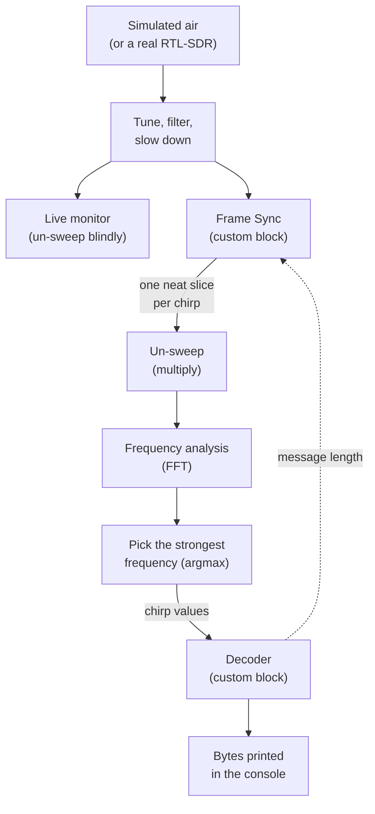
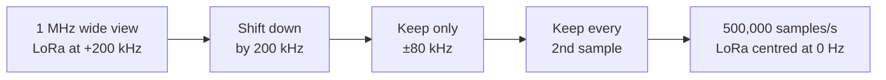
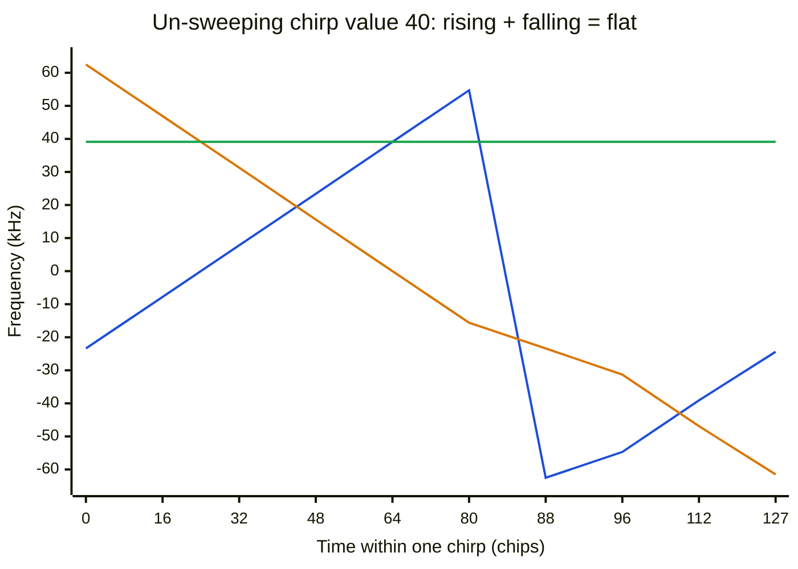
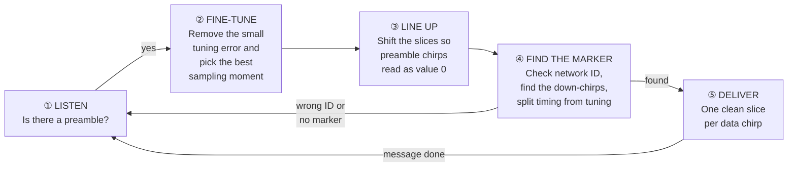
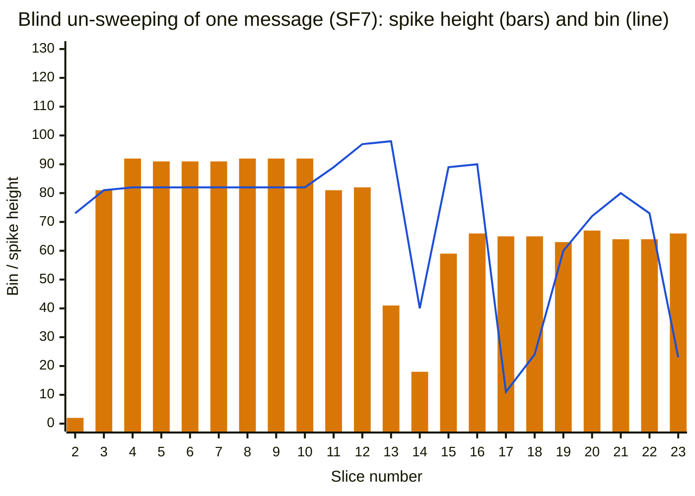
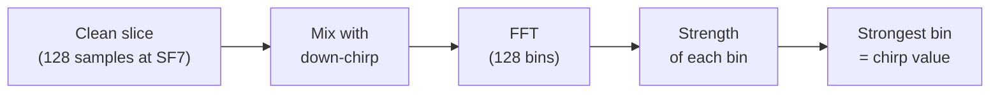

# How the LoRa Receiver Works — A Plain-English Guide

**File:** `lora_trx_sim.grc` (GNU Radio Companion 3.10) — the transmitter simulation plus a complete receiver
**Who this is for:** engineers with a background in RF, radio links and telecom who don't work with signal-processing maths every day.
**Companion documents:**
- `lora_rx_explained.md` covers the same receiver with full equations.
- `lora_rx_dechirp_sync.png` is a six-panel figure computed from the real signal; panels (a)–(f) are referred to below.
- `lora_tx_sim_plain_english.md` explains the transmitter side.

---

## Contents

1. [What the receiver does, in one paragraph](#1-what-the-receiver-does-in-one-paragraph)
2. [The receiver's problem in five minutes](#2-the-receivers-problem-in-five-minutes)
3. [The receiver at a glance](#3-the-receiver-at-a-glance)
4. [The settings you can change](#4-the-settings-you-can-change)
5. [Step 1 — Tuning in (the front end)](#5-step-1--tuning-in-the-front-end)
6. [Step 2 — The core trick: "un-sweeping" a chirp](#6-step-2--the-core-trick-un-sweeping-a-chirp)
7. [Step 3 — Why you can't just un-sweep blindly](#7-step-3--why-you-cant-just-un-sweep-blindly)
8. [Step 4 — Locking on to a transmission (the Frame Sync)](#8-step-4--locking-on-to-a-transmission-the-frame-sync)
9. [Step 5 — Reading each chirp's value](#9-step-5--reading-each-chirps-value)
10. [Step 6 — From chirp values to bits and bytes](#10-step-6--from-chirp-values-to-bits-and-bytes)
11. [What you'll see on the screen](#11-what-youll-see-on-the-screen)
12. [One reception, start to finish](#12-one-reception-start-to-finish)
13. [How we know it works, and what it can't tell you](#13-how-we-know-it-works-and-what-it-cant-tell-you)
14. [Listening to a real LoRa device with the RTL-SDR](#14-listening-to-a-real-lora-device-with-the-rtl-sdr)
15. [Things to try](#15-things-to-try)
16. [Glossary](#16-glossary)

---

## 1. What the receiver does, in one paragraph

The receiver takes the radio signal — from the simulated transmitter, or from a real RTL-SDR dongle — and recovers the exact bytes that were sent. To do that it must:

1. notice that a LoRa transmission has started,
2. work out exactly when each chirp begins and how far off-tune the signal is,
3. "un-sweep" each chirp so its value can be read,
4. undo all the protective coding the transmitter applied.

It prints each received message in the console with a checksum verdict, the measured tuning error and the signal-to-noise ratio. In simulation it decodes every message correctly, even when the signal is weaker than the background noise.

---

## 2. The receiver's problem in five minutes

### 2.1 What arrives

From the transmitter guide: each LoRa chirp sweeps steadily across the 125 kHz channel, and its **data value is where in the sweep it starts** (equivalently, where its jump from top to bottom happens). A message is:

- 8 identical "wake-up" chirps (preamble),
- 2 network-ID chirps (sync word),
- 2¼ downward chirps (start marker),
- the data chirps.

### 2.2 What the receiver doesn't know

The receiver sees a stream of samples. Nothing in it says where a transmission starts, and two things are always off:

| Unknown | Where it comes from | Typical size |
|---|---|---|
| **Timing** — where each chirp begins | The transmitter can start at any moment | Anything from 0 to a whole chirp |
| **Tuning error** (frequency offset) | Neither the node's crystal nor the dongle's crystal is exact | 1 ppm ≈ 0.9 kHz at 923 MHz; a cheap dongle can be 30+ ppm off |
| **Clock drift** | The dongle's crystal also clocks its sampler, so a fast crystal stretches every chirp slightly | A fraction of a sample per chirp, adding up over a long message |

A chirp's value is read from *where its sweep sits in time*. A timing error and a tuning error both make the sweep appear to sit somewhere else. **Most of the receiver's work is measuring and removing these two errors before reading a single value.**

---

## 3. The receiver at a glance



| Stage | Plain-English role | Real-world equivalent |
|---|---|---|
| Simulated air (`Channel Model`) | Adds noise, a tuning error and clock drift — everything a real dongle would introduce | The radio path plus the dongle's imperfections |
| Tune, filter, slow down (`Frequency Xlating FIR Filter`) | Moves the LoRa channel to the centre, cuts away everything outside it, reduces the sample rate | The receiver's mixer, IF filter and ADC rate |
| Live monitor | Un-sweeps the signal on a fixed timetable, without any locking, to show what an unsynchronised receiver sees | An oscilloscope clipped onto the IF |
| **Frame Sync** | Detects a transmission, measures timing and tuning errors, finds the start marker, cuts out one clean slice per data chirp | A LoRa chip's synchroniser |
| Un-sweep + FFT + argmax | Turns each slice into a single number: the chirp's value | A LoRa chip's demodulator |
| **Decoder** | Undoes the scrambling, shuffling and error coding; checks the checksum | The digital part of the LoRa chip |

The two custom blocks are Embedded Python Blocks:

- the **Frame Sync**, because GNU Radio has no block that can decide where to start cutting the signal;
- the **Decoder**, because GNU Radio has no LoRa decoding blocks.

The actual "un-sweeping" and value reading are done by standard GNU Radio blocks.

---

## 4. The settings you can change

The transmitter's settings (`sf`, `cr`, `sync_word` …) also apply to the receiver. The new ones are:

| Setting | Default | Plain meaning |
|---|---|---|
| `sim_snr_db` | 10 dB | Signal-to-noise ratio of the simulated channel. Go negative to see LoRa work below the noise. |
| `sim_ppm` | 10 ppm | Simulated crystal error of the dongle. Creates both a tuning error (−9.2 kHz) and clock drift. |
| `center_freq` | 923.2 MHz | Channel frequency. Needed for real tuning, and to work out clock drift from the tuning error. |
| `if_offset` | 200 kHz | The dongle is tuned this far below the channel, to keep the signal away from the dongle's DC spike. |
| `rtl_ppm` | 0 | Your dongle's crystal correction, if you've measured it. |
| `rtl_gain` | 30 dB | Dongle RF gain. |
| `rx_os` | 4 | Samples per chip the Frame Sync works with. |

---

## 5. Step 1 — Tuning in (the front end)

**Block:** `Frequency Xlating FIR Filter` — one standard block that does the work of a mixer, a filter and a decimator.



1. **Shift.** The dongle is deliberately tuned 200 kHz below the channel, because RTL-SDR dongles have a spike of junk at exactly their tuned frequency. This step slides the LoRa channel back to the centre.
2. **Filter.** Everything outside ±80 kHz is removed. The LoRa signal needs ±62.5 kHz; the rest is noise and neighbours.
3. **Slow down.** Half the samples are dropped, leaving 500,000 per second: **4 samples per chip**.

**Why 4 samples per chip, when reading a chirp only needs 1?** Because of timing. If the receiver takes its one-per-chip samples half a chip off, the result is noticeably worse: about 4 dB weaker and ambiguous between two neighbouring values. With 4 samples per chip the Frame Sync can choose the best of four "sampling moments" and get within ⅛ of a chip.

---

## 6. Step 2 — The core trick: "un-sweeping" a chirp

This is the heart of every LoRa receiver, and it's simple.

### 6.1 Mixing with an opposite sweep

Take the received chirp, sweeping **up**. Mix it with a locally generated chirp sweeping **down** at exactly the same speed. In mixer terms, the output frequency is the sum of the two:

- the incoming chirp's frequency rises steadily,
- the local chirp's frequency falls steadily,
- **so the sum stays constant**: a plain, steady tone.

Panel (b) of the figure shows this: a blue rising sawtooth, an orange falling line, and a flat green result.



> *Blue: the received chirp (value 40), with its jump at chip 88. Orange: the receiver's local down-chirp. Green: the mixer output — a steady 39 kHz tone. At the jump the blue line drops by the full channel width; in the sampled signal this drop wraps back onto the same tone, so the output stays flat. (The green line is the sum taken "modulo" the channel width, which is how a sampled signal behaves.)*

### 6.2 Where the tone ends up is the value

The **frequency of that steady tone equals the chirp's value**. Value 0 gives a tone at the bottom of the range; value 40 gives a tone 40 steps up; and so on. There are 128 possible steps at SF7, each 977 Hz apart.

### 6.3 Reading the tone: an FFT

An FFT is a frequency analyser that splits one chirp's worth of samples into 128 frequency "bins" (at SF7). The steady tone lands in **one bin**, and the strongest bin number is the chirp's value. Panel (c), green, shows a single tall spike.

**This is also where LoRa's below-the-noise ability comes from.** The chirp's energy, spread across the whole channel, is gathered into a single bin. Noise stays spread over all 128 bins, so the signal "sticks out" by a factor of 128 (21 dB). At SF12 there are 4096 bins, giving 36 dB.

In the flowgraph, the un-sweep is a standard `Multiply` block. The frequency analysis is a standard `FFT` block, and picking the strongest bin is a standard `Argmax` block.

---

## 7. Step 3 — Why you can't just un-sweep blindly

### 7.1 Slices in the wrong place

The receiver cuts the signal into chirp-length slices. If a slice doesn't start where a chirp starts, it contains the **end of one chirp and the start of the next**. Each part un-sweeps to its own tone, so the result is two weaker spikes instead of one strong one. Panel (c), red, shows a slice 30 chips late: two smaller spikes, and argmax may pick the wrong one.

### 7.2 Timing and tuning errors look the same

Here is the subtle part:

- A slice that starts **late** makes the tone come out **higher** by the same number of steps.
- A **tuning error** also shifts the tone up or down.

| What's wrong | Effect on an up-chirp's tone |
|---|---|
| Slice starts 10 chips late | 10 bins higher |
| Signal 10 bins (≈ 10 kHz at SF7) too high | 10 bins higher |
| Both | 20 bins higher |

From up-chirps alone, **you cannot tell which is which**. Yet the two errors need different fixes: one by moving the slices, the other by retuning.

### 7.3 Down-chirps break the tie

Un-sweep a **downward** chirp instead (mixing it with an *up*-chirp) and the timing effect **reverses direction**, while the tuning effect doesn't:

| What's wrong | Up-chirp tone | Down-chirp tone |
|---|---|---|
| Slice 10 chips late | +10 | **−10** |
| Signal 10 bins too high | +10 | **+10** |

Measure both and you can separate them. **That is why every LoRa message contains the 2¼ downward chirps (the start marker).** Panel (e) of the figure shows this table as bars.

---

## 8. Step 4 — Locking on to a transmission (the Frame Sync)

The Frame Sync works through four stages for every message:



### ① Listen: is there a preamble?

The Frame Sync un-sweeps the incoming signal slice by slice on an arbitrary timetable, exactly like the live monitor.

- On **noise**, the strongest bin jumps randomly from slice to slice.
- During the **preamble**, all 8 chirps are identical (value 0), so every slice gives the **same** bin — even a misaligned slice, because the chirps join seamlessly.

Rule: **4 slices in a row with their spike in the same bin = a transmission has started.** By chance, noise does this about once every 10 minutes at worst, and a false start is thrown out later at the network-ID check.

That bin is *timing + tuning error mixed together*. The receiver doesn't yet know how much of each.

The chart below is computed from the real signal. It shows one value per slice: the bin (blue line) and how tall the spike is (orange bars).



Reading it:

| Slices | What's happening |
|---|---|
| 2 | Noise before the message: tiny spike, random bin |
| 3–10 | **Preamble:** the bin sits still at 82. The spike is tall, but only 92 of a possible 128, because of the uncorrected small tuning error. |
| 11–12 | **Network ID:** the bin steps up by 8, then 16 (82→90→98; the 89/97 are partial slices) |
| 13–14 | **Start marker:** the spike **collapses**, because a down-chirp mixed with a down-chirp doesn't produce a steady tone |
| 15 on | **Data:** random bins, and lower spikes because each misaligned slice straddles two different chirps |

### ② Fine-tune

**Small tuning error.** Because the preamble repeats exactly, the spike in each slice is the same, except that a tuning error makes its **phase** creep forward by the same amount every slice. A whole-step error makes a full turn (invisible), but the leftover fraction of a step shows up as a phase creep. The Frame Sync measures it and retunes by that fraction.

It's like noticing a slight beat between two nearly-equal tones: you can't count whole cycles, but you can hear the leftover.

**Best sampling moment.** With 4 samples per chip, the Frame Sync tries all four starting points and keeps the one that gives the tallest spike. That's the one closest to the true chip timing.

### ③ Line up

The Frame Sync slides its slice timetable by the preamble's bin number (82 chips in the chart above). Now every preamble chirp reads **value 0**, every network-ID chirp reads its true value (8 and 16), and data chirps would read correctly too.

There is a catch. The slide corrected timing **plus** tuning error, but the tuning error is still in the signal, so the slices are now off by exactly that amount. For up-chirps the two cancel out perfectly, which is why the readings look right. Down-chirps expose the leftover.

### ④ Find the start marker, check the network ID

The Frame Sync now steps forward one chirp at a time and un-sweeps each slice **both ways** (for up-chirps and for down-chirps):

- While the up-chirp result is stronger, it's still the preamble or network ID. It remembers the readings.
- **The first slice where the down-chirp result is stronger is the start marker.**

Three things follow:

1. **Network ID check.** The two readings just before the marker must be the expected ID values (8 and 16 for 0x12). If not, the message belongs to another network and is ignored, which is what a real LoRa chip does.
2. **Tuning error, finally separated.** The down-chirp's bin equals **twice the whole-step tuning error** (panel f: bin −18 means −9 steps = −8.8 kHz at SF7). Add the fraction from ②, and the receiver knows the full tuning error. It reports it in Hz.
3. **Exact timing.** Knowing the tuning error, the Frame Sync knows how much of its earlier slide was really tuning. It corrects the timetable by that amount, and the data starts exactly 2¼ chirps after the marker's start.

**Limit:** this works as long as the tuning error is less than a quarter of the channel width: **±31 kHz** at 125 kHz, about **±34 ppm** at 923 MHz. Beyond that the down-chirp reading wraps around and becomes ambiguous.

### Correcting clock drift

In an RTL-SDR, **one crystal** sets both the tuning and the sampling clock. If it runs 10 ppm fast, the signal appears 9.2 kHz low **and** each chirp lasts 10 ppm more samples than expected. The receiver measures the first, so it can calculate the second, and stretches its slice timetable to match.

Over a short SF7 message this hardly matters. Over a 1.3-second SF12 message at 25 ppm, the slices would drift 4 chips out of line by the end. That was enough to wreck every message in testing until this correction was added.

### ⑤ Deliver

From the start of the data onward, the Frame Sync hands out one clean slice per data chirp:

- correctly timed,
- at the best sampling moment,
- re-tuned,
- drift-corrected.

It labels the first slice "start of message" so the decoder knows where each message begins.

**How does it know when the message ends?** It doesn't, at first; the length is written inside the header. So it delivers the 8 header chirps and waits. The decoder reads the header and **sends the length back** to the Frame Sync (the dashed arrow in §3), and the Frame Sync then delivers exactly the right number of further chirps. If the header's own check fails, the decoder says "abort" and the Frame Sync goes back to listening.

---

## 9. Step 5 — Reading each chirp's value

With aligned, corrected slices, reading values is the simple process from §6, done entirely with standard blocks:



Now every chirp gives one tall spike at the full possible height, instead of the 92 seen during blind listening (bottom-right display, and panel f).

---

## 10. Step 6 — From chirp values to bits and bytes

Each chirp value becomes raw bits in three small steps, mirroring the transmitter:

| Step | What happens | Why |
|---|---|---|
| Subtract 1 | Undoes a +1 offset the transmitter adds | A quirk of the LoRa format |
| Gray code | Rearranges the value so neighbouring values differ in one bit | A near-miss (reading 41 instead of 40) then costs only 1 bit |
| Drop 2 bits (header, and data at SF11/12) | Removes the two "safe mode" filler bits | Those chirps carry 2 fewer bits |

That gives 7 raw bits per chirp at SF7 (5 in the header). From there the decoder runs the transmitter's protective steps backwards: un-shuffle the bits, correct errors, read the header, unscramble the data, check the checksum.

---

## 11. What you'll see on the screen

| Position | Display | What it shows |
|---|---|---|
| Top left | Transmitter spectrum | Same as in the TX flowgraph |
| Top right | **Receiver input spectrum** | The 125 kHz block sitting at +200 kHz, exactly as a dongle tuned 200 kHz low would see it |
| Bottom left | **Blind un-sweeping, one dot per slice** | The chart in §8 ①, live. The display triggers on each message, so it shows a fresh one about 3 times a second. Look for the flat run (preamble), the two steps (network ID) and the dip in the red trace (start marker). |
| Bottom right | **Synchronised result, latest data chirp** | A single sharp spike reaching full height. Its position jumps around because each chirp carries a different value. |

**Why not a waterfall or raster display?** Both of GNU Radio's scrolling displays only draw a few dozen rows per second and silently skip the rest. LoRa produces about 1,000 chirps per second at SF7, so they would show a random sample, not the message. The one-dot-per-slice display plots every slice.

---

## 12. One reception, start to finish

Default settings (SF7, 10 ppm dongle error, 10 dB SNR), one message:

| Receiver stage | Time into message | What it learns |
|---|---|---|
| Listening | 0–4 ms | Four slices in a row at the same bin: a transmission has started |
| Fine-tune | instantly | Small tuning error ≈ −0.46 steps; best sampling moment |
| Line up | instantly | Slide the timetable; preamble now reads 0 |
| Find marker | ~10 ms | Network ID reads 8, 16 ✓; marker bin −18 → tuning error −9.46 steps = **−9.24 kHz** (true: −9.23 kHz) |
| Header | 12–21 ms | 8 chirps → "16 bytes, coding 4/5, checksum on" → length sent back to Frame Sync |
| Data | 21–52 ms | 30 more chirps → 16 bytes → checksum OK → printed |

The console line looks like:

```
[LoRa sync] frame 3: SNR 9.6 dB, CFO -9236 Hz (-9 + -0.46 bins), sync word bins [8, 16], sampling phase 1/4
[LoRa RX] frame 3  len 16  CR 4/5  CRC OK  CFO -9236 Hz  SNR 9.6 dB
          0D CD 7E 4F D9 1A EA 60 64 E9 D0 1D 9F 72 18 E5
```

---

## 13. How we know it works, and what it can't tell you

**What was tested.** The flowgraph was compiled and run in GNU Radio 3.10. A separate test compared every decoded message with the bytes the transmitter actually sent:

| Situation | Result |
|---|---|
| Every SF from 7 to 12, dongle 25–30 ppm off, random timing | Every message decoded exactly |
| All four coding levels, message lengths 2–255 bytes, with and without checksum | Every message decoded exactly |
| SF7, signal 3 dB **below** the noise | 33 of 33 messages |
| SF7, signal 6 dB below the noise | 20 of 33 (Semtech quotes about −7.5 dB as SF7's limit) |
| SF10, 12 dB below the noise | 13 of 13 |
| SF12, 16 dB below the noise | 9 of 9 |
| Tuning error of 33 ppm / 36 ppm at 923 MHz | Works / fails, as predicted by the ±31 kHz limit |
| Receiver set to the wrong network ID | Every message correctly ignored |
| Full flowgraph with displays, SF12, 15 dB below noise, real time | Every message decoded; tuning error measured to within 1 Hz |

**The signal-to-noise figure** printed per message is accurate for weak signals: it showed −16.0 dB for a −15 dB channel. For strong signals it tops out around +15 to +20 dB, so treat high readings as "strong" rather than exact.

**What remains unconfirmed.** The decoder was written as the mirror image of this project's transmitter. That proves the two agree with each other, not that both match a real Semtech LoRa chip. The receiver now gives you a way to settle that: point it at a real LoRa device (§14).

**A correction to the transmitter guide.** The TX documents say the header's "safe mode" lets the receiver tolerate reading a chirp one step off. Testing showed otherwise *for this transmitter/receiver pair*. While the clock-drift bug was present, every chirp read exactly one step low, and every SF12 message failed its checksum. The header only survived because of its strong error correction. Whether real LoRa chips arrange their bits so that this tolerance really exists I'd put at roughly 60/40 that they do. It's one more reason to test against real hardware.

---

## 14. Listening to a real LoRa device with the RTL-SDR

1. **Switch off the simulation.** Disable the whole transmitter section, the `Throttle` and the `Channel Model`. The dongle's own clock then sets the pace.
2. **Switch on the dongle.** Enable `Soapy RTL-SDR Source`; it's already wired in. The radioconda Windows installer includes the RTL-SDR driver for it.
3. **Set the frequency.** Put your device's channel in `center_freq`. LoRa in Indonesia sits around 920–923 MHz; 923.2 MHz is only a placeholder.
4. **Match the transmitter's settings:** `sf`, `bw`, `ldro`, and `sync_word`.
   - **0x34** for LoRaWAN devices.
   - **0x12** for most hobby point-to-point setups (RFM95/SX1276 modules with default libraries).
5. **Check your dongle's crystal.** Dongles with a TCXO (RTL-SDR Blog v3/v4) are within about 1 ppm: no problem. Older dongles can be 30–80 ppm off, beyond the ±34 ppm the receiver can handle. Measure the error once against a known signal and enter it in `rtl_ppm`.
6. **Adjust the live monitor.** Its trigger level assumes the simulator's signal level. With a real signal, set its trigger to Auto or lower the level.
7. **Gain.** Start at 30 dB. Too much gain on a nearby device distorts the signal and blurs the spikes.
8. **What to expect.** LoRaWAN messages are encrypted. You'll receive the correct bytes, but they won't be readable sensor values.

**Not handled:**
- Messages from LoRaWAN **gateways** to devices (downlinks), which use inverted chirps.
- Messages without a header (implicit-header mode).
- Two messages overlapping on the same channel and SF.

---

## 15. Things to try

| Try this | What you'll learn |
|---|---|
| Lower `sim_snr_db` to −5 (SF7), then −15 with `sf = 12` | The spectrum displays show only noise, yet messages still decode. That's the FFT gathering the chirp's energy into one bin. |
| Raise `sim_ppm` to 30, then 40 | At 30 the receiver reports ~−27.7 kHz and decodes. At 40 it exceeds the ±31 kHz limit and stops finding messages. |
| Watch the bottom-left display while changing `sim_ppm` | The preamble's flat run moves to a different bin. It's timing and tuning mixed together. |
| Set the receiver to a different `sync_word` than the transmitter | The console shows "sync word bins … ignored": the network filter at work |
| Set `sim_ppm = 0` | The tuning error reported drops to a few Hz, and the preamble spikes on the bottom-left display get taller (no small tuning error to blur them) |
| Point a real RTL-SDR at an SX1276 hobby module (§14) | The real test of whether this pair matches Semtech's chips |

---

## 16. Glossary

| Term | Meaning here |
|---|---|
| **Un-sweep / de-chirp** | Mixing a received chirp with an opposite-direction chirp so the sweep cancels and a steady tone remains |
| **Down-chirp** | A chirp sweeping from the top of the channel to the bottom; the receiver's local reference, and the start marker on air |
| **FFT** | A frequency analyser that splits a slice into bins; a steady tone lands in one bin |
| **Bin** | One frequency step of the FFT. 128 bins at SF7, 4096 at SF12. The bin of the spike is the chirp's value. |
| **Argmax** | "Which bin is strongest" |
| **Slice / window** | One chirp's worth of samples, cut out for analysis |
| **CFO (carrier frequency offset)** | Tuning error between transmitter and receiver |
| **STO (symbol timing offset)** | How far the receiver's slices are from the true chirp starts |
| **SRO / clock drift** | The dongle's sample clock running slightly fast or slow, stretching chirps |
| **ppm** | Parts per million. 1 ppm at 923 MHz ≈ 923 Hz of tuning error. |
| **Preamble** | The 8 identical wake-up chirps; used to detect a message and measure errors |
| **Sync word** | The network ID, sent as two chirps (8 and 16 for 0x12) |
| **SFD (start-of-frame delimiter)** | The 2¼ downward chirps; separates timing error from tuning error and marks where data begins |
| **IF offset** | Tuning the dongle slightly away from the channel to avoid its DC spike |
| **Front end** | The tune / filter / slow-down stage |
| **Frame Sync** | The custom block that detects, measures and lines up each message |
| **Gray code** | An ordering where neighbouring values differ by one bit |
| **Processing gain** | How much the FFT lifts the signal above the noise by gathering it into one bin: 21 dB at SF7, 36 dB at SF12 |
| **Message port** | A GNU Radio connection that carries messages (like "16 bytes long") rather than a sample stream |
| **TCXO** | Temperature-compensated crystal oscillator; makes a dongle accurate to about 1 ppm |
